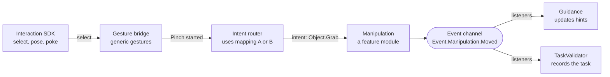
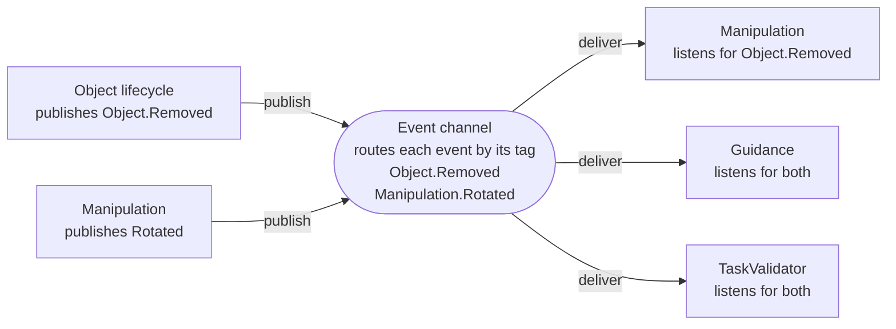
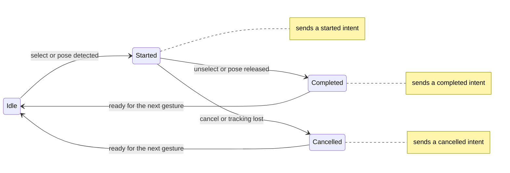

# Core Architecture Design

## 1. Introduction

### 1.1 Purpose

This doc designs the library core, the shared foundation that every feature module of the UI library is built on. It explains how the core works, why it is shaped this way, and how a feature module plugs into it, with worked examples for each part.

### 1.2 Problem

Separate feature modules (navigation, guidance, object lifecycle, manipulation) are being built for one reusable library. Without a shared foundation, each module would:

- read hand input its own way, as the codebase previously did with several separate pinch and poke detection methods
- hard-code its gestures, which blocks the planned A/B gesture comparisons
- call other modules directly, so no module could be reused or tested alone

The core solves these once, so feature modules only implement their own behavior.

### 1.3 Scope

**In scope:**

- The gesture bridge between the Interaction SDK and the library
- Intents and the swappable gesture mapping
- The event channel modules use to communicate
- Shared configuration types
- The plugin layout and how a feature module plugs in

**Out of scope:**

- The behavior of any feature module (each has its own design doc)
- Hand visuals and rendering
- Storage, user identity and app content, which belong to the application
- The TaskValidator's own design, since this doc only covers how it connects to the core

## 2. Constraints and Assumptions

### 2.1 Constraints

- Unreal Engine 5.8, written in C++ (C++20) to the Epic C++ Coding Standard.
- Meta Quest headsets with hand tracking as the primary input.
- Hand input comes from Meta's Interaction SDK. In Unreal it provides ray, poke, grab and pose detection, but no locomotion or gesture-sequence detection.

### 2.2 Assumptions

- The Interaction SDK is already in use, and the core builds on it rather than reading raw hand data.
- Modules communicate through the event channel.
- Gestures are swappable through mapping assets, so A/B conditions need no code changes.
- The A/B condition is chosen before a session and stays the same for every task in it.
- The library stores nothing to disk. The application owns storage.
- The library's APIs are C++ only. Blueprint exposure isn't planned.
- The Gameplay Tag and code prefix is `HTUI`.
- Epic's Gameplay Message Router is a documented dependency that each developer installs.

## 3. Approach

### 3.1 Layered core

The library is arranged in four layers. From top to bottom, they are the application (including study tools such as the TaskValidator), the feature modules, the core, and the platform (Unreal Engine and the Interaction SDK). Dependencies only point down, and the core stays small so feature modules can plug into it like plug-ins. This was chosen because the library's goal is reuse. An integrator should be able to take one module without the rest, and a module author shouldn't need to read anyone else's code. A single large module with a folder per feature would be simpler to start, but nothing would stop one feature from including another, and the separation would erode. The trade-off is that the core's interfaces become hard to change once several modules depend on them, which is why the core is built and stabilized first (Section 11).

For example, imagine a team building a room planner. They want users to add and remove objects, which the object lifecycle module provides. They already have their own code for moving objects, so they don't want the manipulation module. They install only the core and the object lifecycle module. Everything still works, because the object lifecycle module never refers to the manipulation module, so nothing is missing when it's left out.

### 3.2 Event channel

Modules never call each other. A module that needs to react to another subscribes to a named event instead. This means each module can be built, tested and replaced alone, and a new module can react to existing ones without anyone editing them.

Other ways of connecting modules were considered.

- **Direct calls.** One module calls a function on another. This is the simplest option, but the calling module can't be built or used without the module it calls.
- **Interfaces in the core.** The core would define an interface for each kind of interaction, such as "something that can show a hint," and modules would call each other through it. The compiler would still check every call, but the core would need a new interface every time two modules interact, so it would keep growing.
- **Listening directly to another module.** A module would subscribe to another module's own notifications. The listener would then depend on every module it listens to.
- **Connecting modules in the application.** Each app would write its own code to pass information between modules, for example "when navigation finishes a move, tell guidance." Nothing would work until every app wrote that connecting code.

The channel is Epic's Gameplay Message Router, which broadcasts and listens by Gameplay Tag with a struct payload. It comes from Epic's Lyra sample and is a documented dependency that each developer installs, the same way the Interaction SDK is handled.

The cost is that a broadcast is harder to trace than a function call, and listeners are called synchronously in no guaranteed order. A queue wouldn't fix that. A queue fixes the order *events* are delivered in, not the order *listeners* run in, and it would add a frame of delay. Instead, listeners must not depend on each other's order. When one listener needs another's result, it subscribes to the event that result produces. An event debug view (Section 5.3) offsets the tracing cost.

For example, when the object lifecycle module removes a chair, it broadcasts `HTUI.Event.Object.Removed`. Manipulation hears it and drops its rotation handles from the chair. Guidance hears it and completes its "remove an object" hint. Neither needs the other to run first.

### 3.3 Swappable gestures

Modules bind to intents, and a mapping asset binds intents to gestures. The study compares gestures, so hard-coding them would mean a code change and a rebuild per condition. With mappings, a condition is a data asset. Unreal's Enhanced Input already separates actions from the inputs that trigger them, and the Interaction SDK already routes pinch and button input through it, so the core builds on that instead of inventing its own system. The cost is one more step between a hand and an action, and an editor check to catch conflicting mappings.

For example, the study compares two ways of grabbing an object. In condition A the user pinches, and in condition B the user closes their hand into a fist. The team creates two mapping assets. Mapping A binds the `Object.Grab` intent to `Pinch`, and mapping B binds the same intent to `Fist`. Before a session, the administrator selects mapping B. From then on, whenever the Interaction SDK detects a fist, the core fires `Object.Grab`, and the manipulation module grabs the object exactly as it would under mapping A. The manipulation module only ever asked for `Object.Grab`, so its code is identical in both sessions. Switching conditions means picking a different asset, with no code change and no rebuild.

### 3.4 Typed data

Data passes between modules as typed structs, not JSON or strings. Structs are checked when the code compiles and cost nothing to pass. JSON appears only where data leaves the engine, such as the TaskValidator's results file.

### 3.5 Module per feature

In Unreal, a module is a separately compiled unit of code with its own build file, which lists the other modules it is allowed to use. Each feature is its own module, and the core is one more. Every feature module's build file lists only the core, never another feature. If code in the navigation module tries to include a header from the guidance module, the build fails with an error. This means the compiler itself enforces the rules from Sections 3.1 and 3.2, instead of relying on people to remember them. The cost is more build files to maintain, plus an export macro on any class or function that other modules use.

## 4. At a Glance



The Interaction SDK detects the hand. The gesture bridge turns that into a named gesture, and the router turns the gesture into an intent using the active mapping. Manipulation receives only the intent, and other modules hear about its result through the event channel.

## 5. Component Design

The core has four components. They are the gesture bridge (5.1), the intent router with its mappings (5.2), the event channel (5.3), and configuration (5.4). Hand input flows through the first two in order, and the other two serve every module.

### 5.1 Gesture bridge

The gesture bridge is the only code that talks to the Interaction SDK's input. The SDK already does the hard part of detecting hands. It recognizes pinches and named hand poses, and it handles pokes on interactable surfaces. It reports pinches through Enhanced Input, which is Unreal's system for connecting raw inputs, such as a key, a button or a pinch, to named actions that code listens for. Each SDK interaction also reports a fixed set of pointer events, which are hover, unhover, select, unselect, move and cancel.

The bridge turns each of these SDK signals into one generic **gesture** with three possible outcomes. It *started*, it *completed*, or it was *cancelled*. A gesture is just a name, such as `Pinch`, `Fist`, `PalmUp` or `WristButton`, and nothing in the core assumes which gestures the study will use. A cancelled gesture, which the SDK reports when tracking is lost or an interaction is interrupted, never counts as completed.

| SDK signal | Gesture outcome |
| --- | --- |
| Select (for example, a pinch on a ray) | Started |
| Unselect | Completed |
| Cancel | Cancelled |
| Pose detected, then released | Started, then completed |
| Pose lost before release | Cancelled |

For example, the wrist toolkit's "remove" button is an SDK poke surface. A fingertip press arrives as select and unselect. The bridge reports `WristButton` started, then completed, and the object lifecycle module receives its `Object.Remove` intent without knowing a button was involved.

Besides gestures, the bridge exposes each hand's **aim pose**, which is where the hand is pointing. It comes from the SDK's far-field pointer, which the hand's pose drives like a controller's laser pointer. Modules that point at things from a distance, such as navigation's teleport arc or object placement aiming at the floor, read it from the core instead of from the SDK. When a hand isn't tracked, the query reports no pose, so the module can hide its aim visuals.

For example, navigation draws its arc from the right hand's aim pose every frame. When the hand drifts out of view, the query returns nothing, and the arc hides until the hand returns.

### 5.2 Intents and the mapping

An **intent** is what the user means, such as `Object.Grab` or `Navigation.Enter`. Intents are Enhanced Input actions defined by the library, and modules subscribe to intents without ever seeing gestures.

A **mapping asset** says which gesture fires which intent, grouped into **contexts**. Contexts are Enhanced Input mapping contexts, so only the ones that are currently active are evaluated, and a higher-priority context wins when two map the same gesture. A module adds its context when it becomes active and removes it when done. A mistake in a mapping asset could give one gesture two meanings in the same context, so an editor check warns about it before the asset is ever used in a session.

For example,

| Intent | Mapping A | Mapping B |
| --- | --- | --- |
| `Object.Grab` | Pinch | Fist |
| `Object.Remove` | Wrist button | Palm-down pose, held |
| `Manipulation.RotateMode` | Palm-up pose | Wrist button |
| `Navigation.Confirm` | Pinch | Pinch |

Pinch appears twice in mapping A, for grabbing and for confirming a teleport, but in different contexts. It confirms only while navigation's context is active, and grabs otherwise.

The router also answers two questions about the active mapping. It reports which gestures currently fire a given intent, and the name of the active condition (A or B). Guidance uses the first to show the gesture the participant will actually use, and the TaskValidator uses the second to label its results. Keeping the answer in the router means the mapping asset stays the one place gestures are defined.

For example, under mapping B, asking which gesture fires `Object.Grab` returns `Fist`, so guidance's grab hint plays the fist demonstration from the same hint asset it uses under mapping A.

### 5.3 Event channel

The event channel is Epic's Gameplay Message Router, wrapped by a thin core subsystem. Modules **broadcast** an event (a Gameplay Tag plus a typed struct) and **listen** for events by tag, and delivery happens in the same frame.

- Listeners must not depend on the order they're called in (Section 3.2).
- A listener may broadcast another event, up to a fixed depth, so a loop can't run forever.
- A console command shows the last events with their payloads, to make the flow traceable.
- Wrapping the Router means it could be replaced later without touching any module.



Manipulation appears on both sides because a module can publish its own events and listen for others. It still never calls the object lifecycle module directly.

For example, when manipulation finishes a rotation it broadcasts `HTUI.Event.Manipulation.Rotated` with the object and its new angle. Guidance completes its rotation hint. Manipulation doesn't know guidance exists.

### 5.4 Configuration

- **Project settings** hold the default mapping asset.
- **Data assets** hold the mapping assets. Feature modules could also keep their own tunable settings in data assets, for example a rotation snap step for manipulation or the number of successes before a hint ends for guidance. Each module's design doc decides whether to use this approach.
- Every value in the core has a safe default, so the core works with no asset assigned.

For example, if the manipulation module kept its rotation snap in a settings asset with a default of 15 degrees, a team that needs finer adjustments could assign an asset with 5 degrees, with no code changes.

### 5.5 Connecting the TaskValidator

The TaskValidator is not part of the core and not a feature module. It sits in the application layer, alongside the apps that use the library. Like an app, it may depend on the feature modules' public headers, so it can read payloads such as `FObjectPlacedMessage`, while no module ever knows it exists. A peer module couldn't do this, which is why the validator isn't one.

It connects in four ways:

- **Session setup.** It reads the active condition's name from the router, so every result is labelled A or B automatically.
- **Task definitions as data.** Each task names the event that starts it and the event that ends it, plus any events to count along the way, such as re-grabs.
- **Measuring from events.** It listens for each task's start and end events and keeps every metric internally, such as time to success, error counts, and cancelled intents as a sign of tracking trouble. Modules never compute or report metrics. They just announce what happened.
- **Its own output and controls.** It writes its own results file (JSON, built from the same structs). The administrator's controls, such as starting a task, noting an intervention and ending a session, are its own keyboard input on the PC, not library intents, so they can't collide with participant gestures.

For example, the task "place the chair on the marker" starts on `Object.CatalogOpened`, succeeds on an `Object.Placed` within 10 cm of the marker, and counts every `Manipulation.Grabbed` after the first as a re-grab. Its result records the time, the re-grab count, the placement error and the condition.

Because modules only announce what happened, adding or changing a metric means changing the validator, never a module. The one requirement on modules is that their events carry enough data, so each module's design doc lists its events and payloads. For example, `Object.Placed` needs the final position for placement error to be computed.

## 6. Runtime Behavior

These scenarios walk through the core step by step, using mapping A from Section 5.2. Every gesture follows the lifecycle below, whatever gesture it is.



The Interaction SDK decides when a gesture starts and ends, and the core only reacts to its outcome.

### 6.1 Grabbing and removing an object

1. The participant points at a chair and pinches. The SDK reports a select on its ray. The bridge reports `Pinch` started.
2. The mapping finds `Object.Grab` in the default context. The router sends a started intent, and manipulation attaches the chair to the hand.
3. They release. The SDK reports unselect. The bridge reports `Pinch` completed, and manipulation drops the chair where it is.
4. Manipulation broadcasts `Event.Manipulation.Moved` with the chair and its new position.
5. They press the wrist toolkit's remove button. The bridge reports `WristButton` completed, and the object lifecycle module receives `Object.Remove` for the selected chair.
6. Object lifecycle removes it and broadcasts `Event.Object.Removed`. Manipulation forgets the chair, and guidance completes its removal hint.

### 6.2 Tracking lost mid-gesture

1. The participant is pinching to drag a table across the room.
2. Their hand moves behind the other hand and the SDK loses tracking. It reports cancel.
3. The bridge reports `Pinch` cancelled. The router sends a cancelled intent, never a completed one.
4. Manipulation returns the table to where the drag began.

A cancelled gesture is never treated as completed. Otherwise a drop the participant never chose would land the table wherever their hand was last seen.

### 6.3 Setting the A/B condition

1. Before the session, the administrator selects mapping B in the session setup.
2. The core loads mapping B once. It doesn't change until the session ends.
3. Every task in the session uses mapping B, where grab is a fist and remove is a held palm-down pose.
4. No module's code changed between condition A's sessions and condition B's.

### 6.4 Two modules want the same gesture

1. The participant is in navigation, so its context is active, and pinches while the aim ray crosses a chair.
2. Navigation's context maps pinch to `Navigation.Confirm`, while the default context maps pinch to `Object.Grab`.
3. Navigation's context has higher priority, so only the confirm fires. The chair is not grabbed.
4. After the teleport, navigation removes its context. The next pinch grabs again.

### 6.5 A new module plugs in

1. A developer creates a measuring-tape module whose build file depends only on the core.
2. They define its intents (`Measure.Place`), its events (`Event.Measure.Placed` with a payload struct) and its settings asset.
3. They add the new intent to each mapping asset, and the editor check confirms no conflicts.
4. At startup the module subscribes to its intent through the router.
5. Its events appear in the event debug view immediately, and guidance can add a measuring hint by subscribing to `Event.Measure.Placed`. No other module changed.

## 7. API Definition

These are brief sketches of the core's public types, written to help implement the stories in Section 11. They are not representative of the final implementation, and names and signatures will change as the stories are built. Names use the `HTUI` prefix, and the APIs are C++ only.

### 7.1 Gestures

```cpp
UENUM() enum class EHTUIHand : uint8 { Left, Right, None };
UENUM() enum class EHTUIGestureOutcome : uint8 { Started, Completed, Cancelled };

USTRUCT()
struct FHTUIGestureSignal
{
    GENERATED_BODY()
    UPROPERTY() FName Gesture;                 // "Pinch", "Fist", "PalmUp", "WristButton"
    UPROPERTY() EHTUIGestureOutcome Outcome;
    UPROPERTY() EHTUIHand Hand = EHTUIHand::None;
};

// One subclass per kind of Interaction SDK signal: select/unselect/cancel,
// pose detection, poke surfaces. Each reports generic gesture signals.
UCLASS(Abstract)
class HTUICORE_API UHTUIGestureSource : public UObject
{
    GENERATED_BODY()
public:
    virtual void Activate(UWorld* World);
    virtual void Deactivate();
protected:
    void Report(const FHTUIGestureSignal& Signal);   // forwards to the router
};
```

```cpp
// Aim pose, read from the SDK's far-field pointer.
UCLASS() class HTUICORE_API UHTUIAimSubsystem : public UWorldSubsystem
{
    GENERATED_BODY()
public:
    // False when the hand isn't tracked; callers hide their aim visuals.
    bool GetAimPose(EHTUIHand Hand, FTransform& OutPose) const;
};
```

### 7.2 Mapping and intent router

```cpp
USTRUCT() struct FHTUIGestureBinding
{
    GENERATED_BODY()
    UPROPERTY() FName Gesture;                       // "Pinch"
    UPROPERTY() TObjectPtr<UInputAction> Intent;     // IA_Object_Grab
    UPROPERTY() EHTUIHand Hand = EHTUIHand::None;    // None = either hand
};

USTRUCT() struct FHTUIContextBindings
{
    GENERATED_BODY()
    UPROPERTY() TObjectPtr<UInputMappingContext> Context;
    UPROPERTY() int32 Priority = 0;
    UPROPERTY() TArray<FHTUIGestureBinding> Bindings;
};

// One asset per A/B condition.
UCLASS() class HTUICORE_API UHTUIGestureMapping : public UPrimaryDataAsset
{
    GENERATED_BODY()
public:
    UPROPERTY() FName ConditionName;                 // "A", "B"
    UPROPERTY() TArray<FHTUIContextBindings> Contexts;
};

USTRUCT() struct FHTUIIntentEvent
{
    GENERATED_BODY()
    UPROPERTY() TObjectPtr<const UInputAction> Intent;
    UPROPERTY() EHTUIGestureOutcome Outcome;         // Started, Completed, Cancelled
    UPROPERTY() EHTUIHand Hand;
};

UCLASS() class HTUICORE_API UHTUIIntentRouter : public UWorldSubsystem
{
    GENERATED_BODY()
public:
    void SetMapping(UHTUIGestureMapping* Mapping);   // once, at session start
    void AddContext(UInputMappingContext* Context);
    void RemoveContext(UInputMappingContext* Context);
    FDelegateHandle BindIntent(const UInputAction* Intent, FHTUIIntentDelegate::FDelegate Callback);
    void UnbindIntent(const UInputAction* Intent, FDelegateHandle Handle);

    // Questions about the active mapping.
    TArray<FHTUIGestureBinding> GetBindingsForIntent(const UInputAction* Intent) const;
    FName GetActiveConditionName() const;            // "A" or "B"
};
```

### 7.3 Event channel

```cpp
USTRUCT() struct FHTUIEventHeader
{
    GENERATED_BODY()
    UPROPERTY() double Time = 0.0;
    UPROPERTY() FName SourceModule;
    UPROPERTY() EHTUIHand Hand = EHTUIHand::None;
    UPROPERTY() FGuid RequestId;
};

// Thin wrapper over the Gameplay Message Router, so it can be replaced later.
UCLASS() class HTUICORE_API UHTUIEventChannel : public UWorldSubsystem
{
    GENERATED_BODY()
public:
    template <typename TMessage>   // TMessage starts with an FHTUIEventHeader
    void Broadcast(FGameplayTag Channel, const TMessage& Message);

    template <typename TMessage>
    FHTUIListenerHandle Listen(FGameplayTag Channel,
        TFunction<void(FGameplayTag, const TMessage&)> Callback);

    void Unlisten(FHTUIListenerHandle Handle);
};
```

### 7.4 How a feature module uses the core

```cpp
// Object lifecycle module, simplified.
void UHTUIObjectLifecycleComponent::BeginPlay()
{
    Super::BeginPlay();
    Router = GetWorld()->GetSubsystem<UHTUIIntentRouter>();
    Events = GetWorld()->GetSubsystem<UHTUIEventChannel>();

    Router->BindIntent(IA_Object_Remove,
        FHTUIIntentDelegate::FDelegate::CreateUObject(this, &ThisClass::OnRemove));
}

void UHTUIObjectLifecycleComponent::OnRemove(const FHTUIIntentEvent& Intent)
{
    if (Intent.Outcome != EHTUIGestureOutcome::Completed || !Selected) return;

    FObjectRemovedMessage Msg;
    Msg.Header = MakeHeader(Intent);
    Msg.Object = Selected;
    Selected->Destroy();
    Events->Broadcast(TAG_Event_Object_Removed, Msg);
}
```

The module never mentions a pinch, a button, guidance or the validator. It only knows intents and events.

## 8. Data Contracts

Every event payload is a struct that begins with the shared header, so any listener, including the TaskValidator, can read any module's events the same way.

### 8.1 Event payloads

- Payload structs are named `F<Module><Event>Message`, and tags follow `HTUI.Event.<Module>.<PastTenseVerb>`. Tags are in past tense because events describe something that already happened. Requests are API calls, not events.
- Every payload's first field is `FHTUIEventHeader Header`, which holds the time, source module, hand and request ID.
- The request ID ties an outcome to the request that caused it.
- Once other modules listen to an event, its payload only gains new fields. Existing fields are never renamed or removed, so listeners written against the old payload keep working.
- Each module owns the events it publishes and lists them in its design doc. The shared tag list lives in the core, and changes are reviewed by another module's owner.

```cpp
USTRUCT() struct FObjectPlacedMessage
{
    GENERATED_BODY()
    UPROPERTY() FHTUIEventHeader Header;
    UPROPERTY() TObjectPtr<AActor> Object;
    UPROPERTY() FName CatalogId;        // which object type was placed
    UPROPERTY() FTransform Placement;
    UPROPERTY() bool bValidPlacement;
};
```

### 8.2 Data leaving the engine

When data leaves the engine, such as the TaskValidator's results, the same structs are written as JSON with Unreal's `FJsonObjectConverter`, which converts between UStructs and JSON. For example, a placement task's result could look like the following.

```json
{
  "schemaVersion": 1,
  "taskId": "PlaceChairAtMarker",
  "mapping": "B",
  "outcome": "Success",
  "durationSeconds": 21.7,
  "placement": { "catalogId": "Chair", "validPlacement": true, "errorCm": 3.2 }
}
```

The exact fields are the validator's decision. The core's part is that the structs it reads are typed and stable.

### 8.3 Versioning

Each exported file includes a `schemaVersion` number. If the validator later adds, renames or removes a field, the number goes up. Analysis scripts check it before reading a file, so a script written for version 1 can warn about a version 2 file instead of silently reading the wrong fields. This matters when results from early and late study sessions are analyzed together. Unreal's converter can also change the capitalization of field names when it writes JSON, so the export is tested against a saved sample file to catch that.

## 9. Module Packaging

The library ships as one Unreal plugin with a core module, one runtime module per feature, and an editor-only module. An editor-only module loads only inside the Unreal editor and is left out of packaged builds, so it can hold development tools, such as the mapping conflict check and the event debug view, without adding anything to the shipped app. Each module's build file lists only what it may depend on, so the layer rules are checked on every compile.

### 9.1 Plugin layout

```
Plugins/HTUI/
  HTUI.uplugin
  Source/
    HTUICore/              gesture bridge, intent router, event channel wrapper
      Public/              headers other modules may include
      Private/             implementation, invisible to other modules
      HTUICore.Build.cs
    HTUINavigation/
    HTUIGuidance/
    HTUIObjects/           object lifecycle (name subject to change)
    HTUIManipulation/      manipulation (name subject to change)
    HTUIEditor/            editor-only tools (mapping conflict check, asset validation, event debug view)
  Content/
    Intents/               the library's input actions (IA_Object_Grab, ...)
    Mappings/              MappingA, MappingB
  Config/
    Tags/HTUITags.ini      the shared list of event tags
```

### 9.2 Dependencies

```csharp
// HTUIObjects.Build.cs
PublicDependencyModuleNames.AddRange(new[] { "Core", "CoreUObject", "Engine", "GameplayTags", "EnhancedInput", "HTUICore" });
// No HTUINavigation, HTUIGuidance or HTUIManipulation. A peer include fails to compile.
```

- Only `HTUICore` reads Interaction SDK *input* (selects, poses, pokes).
- Feature modules may still use the SDK's interactable components on objects, such as a grabbable on a chair, since that is behavior on the object rather than input.
- `HTUIEditor` may depend on any runtime module, since it never ships in a packaged app.

## 10. Non-Functional Targets

Each target names how it is checked. These values are subject to change, but each must stay measurable and testable.

| Quality | Target | How it's verified |
| --- | --- | --- |
| Performance | Core work under 0.5 ms of game-thread time per frame | Unreal Insights capture in the headset |
| Robustness | 0 completed intents from a cancelled gesture | Automated test that injects a started then cancelled gesture |
| Swappable gestures | Switching mapping A to B needs 0 code changes and 0 rebuilds | Integration test runs the same injected sequence under mappings A and B without rebuilding |
| New module | Adding a module needs 0 edits to existing modules | Sample module built from the template in CI |
| Isolation | A peer include fails the build | CI includes a deliberate violation that must fail |
| Testability | Core logic runs without a headset | Automated tests inject gestures and intents through Enhanced Input |

## 11. Epic and User Stories

**Library Core epic.** As a module author, I want a shared gesture, intent and event foundation, so that my module handles only its own behavior and works alongside every other module.

The core is its own epic, separate from the feature modules, and is built first since every module depends on it. Stories are ordered so each builds on the one before.

**CORE-1. Broadcast and listen for events.** As a module author, I want to publish and subscribe to named events, so that modules react to each other without calling each other.

- [ ] Given a listener on a tag, when a module broadcasts on that tag, then the listener receives the payload in the same frame.
- [ ] Given a listener expects a different payload type, then an error is logged naming the tag and both types.
- [ ] A console command lists the last 50 events with their payloads.

**CORE-2. Bridge Interaction SDK selects to gestures.** As a module author, I want SDK input reported as generic gestures, so that I never touch the SDK's input myself.

- [ ] Given an SDK select, unselect or cancel, then the bridge reports the named gesture as started, completed or cancelled.
- [ ] Only the core module includes Interaction SDK input headers.

**CORE-3. Fire intents from a mapping.** As a module author, I want to bind to intents, so that gestures can change without changing my code.

- [ ] Given a mapping binds `Pinch` to `Object.Grab`, when a pinch completes, then subscribers to that intent receive a completed intent.
- [ ] Given two active contexts map the same gesture, then only the higher-priority context's intent fires.
- [ ] Given a gesture is cancelled, then subscribers receive a cancelled intent and never a completed one.

**CORE-4. Inject gestures and intents in tests.** As a module author, I want to send gestures and intents from automated tests, so that I can test my module without a headset.

- [ ] Given a test injects `Pinch` started and then completed, then subscribers to the mapped intent receive a started and then a completed intent.
- [ ] Given a test injects an intent directly, then its subscribers receive it as if it came from a gesture.

**CORE-8. Expose each hand's aim pose.** As a module author, I want to know where a hand is pointing, so that I can draw aim visuals without reading the SDK.

- [ ] Given a tracked hand, then `GetAimPose` returns the SDK's far-field pointer pose for that hand.
- [ ] Given an untracked hand, then `GetAimPose` returns false.

**CORE-5. Choose the mapping before a session.** As a study administrator, I want to pick mapping A or B before a session, so that both conditions run without a rebuild.

- [ ] Given mapping B is selected at session start, then every intent in the session resolves through mapping B.
- [ ] The mapping can't change mid-session.
- [ ] The active condition's name is available to any listener, such as the TaskValidator.

**CORE-6. Catch mapping conflicts in the editor.** As a study administrator, I want conflicting mappings flagged before a session, so that a mistake can't reach a participant.

- [ ] Given two intents use the same gesture in one context, then the mapping asset shows an error naming both.

**CORE-9. Answer questions about the active mapping.** As a module or tool author, I want to ask which gesture fires an intent and which condition is active, so that hints and study results match the session.

- [ ] Given mapping B binds `Object.Grab` to `Fist`, then `GetBindingsForIntent` for `Object.Grab` returns `Fist`.
- [ ] `GetActiveConditionName` returns the name of the mapping chosen at session start.

**CORE-7. Bridge poses and pokes.** As a module author, I want pose and button gestures, so that A/B conditions can compare more than pinch.

- [ ] Given the SDK detects a configured pose, then the bridge reports it as started, then completed on release or cancelled if lost.
- [ ] Given a poke on a named SDK surface, such as the wrist toolkit, then the bridge reports it as a gesture.

**CORE-10. Provide a module template.** As a module author, I want a starting template and short steps for adding a module, so that every new module plugs into the core the same way.

- [ ] Given the template is copied and renamed, then it builds against the core with no edits to other modules.
- [ ] The steps cover the build file, adding event tags to the shared list, adding intents to every mapping asset, and running the conflict check.
- [ ] A module made from the template shows its events in the event debug view without further setup.

## 12. Testing

Most of the core can be tested without a headset, because gestures and intents can be injected through Enhanced Input. In-headset checks cover only what needs a real hand.

**Unit tests** (Unreal Automation, logic in isolation):

- The router respects context priority, fires one intent per gesture, and never completes a cancelled gesture (CORE-3)
- The event channel delivers payloads, reports payload type mismatches, and stops at the broadcast depth limit (CORE-1)
- The selected mapping stays fixed for the whole session (CORE-5)
- The conflict check rejects a mapping with a duplicate gesture in one context (CORE-6)

**Integration tests** (a test level, injected input):

- Injecting "pinch started, pinch completed" over a chair fires `Object.Grab`, then `Event.Manipulation.Moved` (Section 6.1)
- Injecting "pinch started, pinch cancelled" during a drag fires no completed intent, and the object returns (Section 6.2)
- Running the same injected sequence under mappings A and B produces different intents only where the mappings differ
- A sample module built from the template links against the core, and its events appear in the debug view

**Build checks** (CI):

- A deliberate peer include in a test module must fail to compile

**In-headset checks:**

- Each gesture in both mappings is recognized for several team members' hands
- Losing tracking mid-drag cancels cleanly
- Core stays under 0.5 ms per frame in Unreal Insights

## 13. Risks and Mitigations

| Risk | Impact | Mitigation |
| --- | --- | --- |
| Core interfaces change after modules depend on them | Every module breaks | Build and stabilize the core before the feature modules, and have every module owner review later changes |
| Event flow is hard to trace | Slow debugging | Event debug view (CORE-1), plus request IDs that link related events |
| The Interaction SDK in Unreal lacks a gesture the study wants, such as a gesture sequence | That condition can't be built as planned | Conditions use poses, pokes and selects the SDK supports. A custom gesture source is possible but costs time |

## 14. References

- [Meta: Getting started with Interaction SDK for Unreal (Enhanced Input mapping)](https://developers.meta.com/horizon/documentation/unreal/unreal-isdk-getting-started/)
- [Meta: Pointer events in Interaction SDK](https://developers.meta.com/horizon/documentation/unreal/unreal-isdk-pointer-events/)
- [Meta: Interaction SDK for Unreal, overview](https://developers.meta.com/vr/documentation/unreal/unreal-isdk-overview/)
- [Meta: Hand tracking in Unreal (feature availability)](https://developers.meta.com/vr/documentation/unreal/unreal-hand-tracking-overview/)
- [Epic: Enhanced Input](https://dev.epicgames.com/documentation/unreal-engine/enhanced-input-in-unreal-engine)
- [Epic: Unreal Engine modules](https://dev.epicgames.com/documentation/en-us/unreal-engine/unreal-engine-modules)
- [Epic: FJsonObjectConverter](https://dev.epicgames.com/documentation/unreal-engine/API/Runtime/JsonUtilities/FJsonObjectConverter)
- [Mark Richards, *Software Architecture Patterns*, Ch. 3: Microkernel Architecture](https://www.oreilly.com/library/view/software-architecture-patterns/9781491971437/ch03.html)
