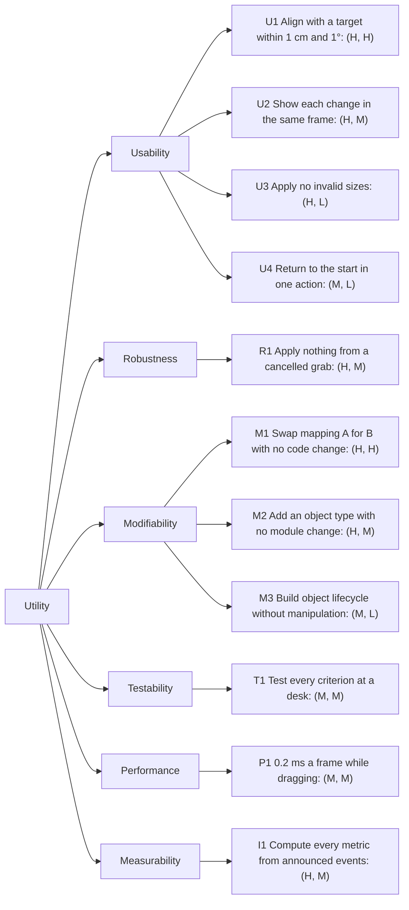
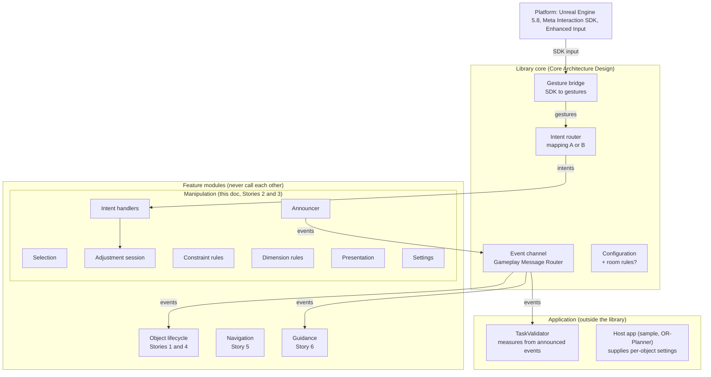
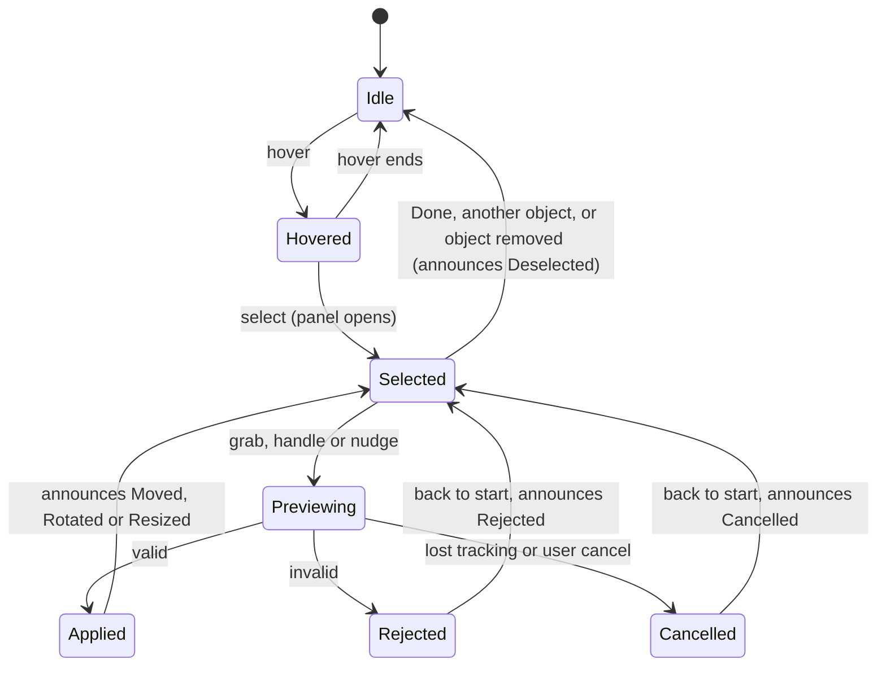

# Core Architecture: Object Manipulation

## 1. Introduction

### 1.1 Purpose

This doc designs the manipulation feature module, which covers Story 2 (adjust an object's position and orientation) and Story 3 (set object dimensions). It explains where the module sits in the library, what it is responsible for, what it announces to the rest of the library, and which quality goals shape it. Implementation choices are left to the sub-stories; for everything structural it follows the Library Core Architecture doc \[11\].

### 1.2 Problem

Users must place objects accurately by hand in VR, but hand tracking is noisy and has no physical feedback. So one style of control is not enough: a fast, rough adjustment and a slow, exact one are both needed, and the user has to see what changed. The study also compares gestures, so the module can't decide which gesture moves an object. Other parts of the library react to manipulation (guidance hints, the TaskValidator's measurements, object lifecycle), so they must hear about it without depending on it. The sample's furniture already has move, rotate and width tools, but they are tied to one kind of object and to their own pinch detection.

### 1.3 Scope

In scope:

- Choosing an object to adjust, and showing that it is ready
- Moving and rotating it, with coarse and precise control
- Showing what changed
- Editing the dimensions that apply to it, with clear units and ranges, and blocking invalid values
- The intents the module listens to, the events it announces, and its settings

Out of scope:

- Adding and removing objects (Object Lifecycle design doc)
- Moving the user and first-time guidance (Navigation and Guidance design doc)
- The gesture bridge, the intent router and the event channel (Library Core Architecture doc)
- Storage, user identity, networking and app content, which belong to the application

### 

## 2. Constraints, Assumptions and Open Questions

### 2.1 Constraints

These come from the Library Core Architecture doc and apply to every feature module \[11, Secs. 2.1, 3, 9.2\].

- Unreal Engine 5.8, C++20, Epic C++ Coding Standard.
- Meta Quest with hand tracking as the primary input.
- Only the core reads Interaction SDK input. The module may still put SDK interactable components on objects, such as a grabbable, because that is behavior on the object, not input.
- The module depends on the core only. It never includes another feature module, and the build enforces it.
- Modules communicate only through the event channel; they never call each other.
- The module binds to intents, never to gestures, so an A/B condition is a mapping asset, not a code change.
- The library stores nothing to disk.

### 2.2 Assumptions

Made without stakeholder input; each one is checked in a sub-story or an open question.

- One user edits the room at a time. Networking, if needed, is the application's concern.

The application says, per object, whether it can move, rotate or change size, and within what limits.

- Values are stored in centimetres and degrees, the engine's units; only display converts.
- The A/B condition is fixed for a session (core assumption \[11, Sec. 2.2\]), so the module never sees a gesture change mid-task.
- Undo of finished edits is not required by Stories 2 and 3; returning to where an adjustment began is.

### 2.3 Open questions

- [ ] **Selection:** Stories 1, 2 and 4 all act on "the selected object". Which module announces selection? This doc proposes manipulation (Section 8.4), to confirm with the Object Lifecycle owner.
- [ ] **Placement rules:** both object lifecycle and manipulation need "is this pose allowed?". Should the room rules be a shared configuration type in the core? (Section 8.5)
- [ ] **Undo across modules:** if undo is wanted later, one history across modules needs a core decision.
- [ ] **Units:** should dimensions be shown in inches as well as centimetres? (Section 5)
- [ ] **Steps:** does Arthrex have standard snap steps for position, rotation and size?
- [ ] **SDK transformers:** can the Unreal Interaction SDK's grab transformers apply our constraints directly, or does the module need its own?
- [ ] **Rotate intent name:** the core doc's mapping table uses `Manipulation.RotateMode`, while the Navigation and Guidance doc's rotate hint demonstrates `Manipulation.Rotate`. This doc uses `Manipulation.RotateMode`; the two docs' owners should settle one name.

## 3. From the Stories

Both stories have all three clauses, so the benefit doesn't have to be guessed. The benefits are the most useful part: "accurately" makes precision a driver, and "match it to my space or requirements" says the limits on an object come from outside the module.

### 3.1 Role, goal and benefit

| Story | As a | I want to | So that | What the benefit implies |
| --- | --- | --- | --- | --- |
| 2. Adjust position and orientation | User | Reposition and rotate an object | I can place it accurately in my room | Precision matters more than speed; the user needs coarse and fine control and proof that the change happened |
| 3. Set object dimensions | User | Enter dimensions for an object | I can match it to my space or requirements | Sizes are typed values with units and limits; limits belong to the object and the room, not to the module |

Acceptance criteria that shape the architecture:

- "I can select an object" (Story 2) is shared with Stories 1 and 4, so selection is a cross-module concern.
- "Coarse and precise adjustments" (Story 2) asks for two control modes over the same change.
- "I can tell when the position or orientation has changed" (Story 2) asks for feedback on every change.
- "Units and acceptable value ranges are clear" and "invalid values can't be applied" (Story 3) ask for validation before a change takes effect.
- "The dimensions that apply to the selected object" (Story 3) means each object declares its own dimensions.

### 3.2 Concepts and responsibilities

Nouns become candidate concepts; verbs become their responsibilities.

| Concept (noun) | Responsibilities (verbs) | Related to |
| --- | --- | --- |
| Object | Is selected, adjusted and resized | Has a placement and dimensions |
| Placement (position and orientation) | Changes within its object's limits | Belongs to an object; checked against the room |
| Adjustment (coarse or precise) | Moves or turns by a step; can be cancelled | Changes a placement |
| Dimension | Is edited, validated and applied | Belongs to an object; described by a spec |
| Dimension spec (unit, range, step) | Says what values are allowed and how they read | Describes a dimension |
| Room | Defines which poses and sizes are valid | Holds objects |
| Change indication | Shows what changed and by how much | Follows every applied change |

### 3.3 Services

Grouping the responsibilities gives five services inside the module:

1. **Selection:** which object is being adjusted, and telling others.
2. **Placement adjustment:** coarse and precise moves and turns within limits.
3. **Dimension editing:** specs, pending values, validation, applying.
4. **Feedback:** showing state, previews and what changed.
5. **Announcement:** telling the rest of the library what happened, through events.

## 4. Architecturally Significant Requirements

With no stakeholder access for these stories, the ASRs come from the stories, the core doc's rules \[11\] and the study's needs.

### 4.1 Where manipulation sits among the stories

Clustering the six stories by workflow step gives four groups. Manipulation is the refine step: it acts on objects other modules create, and its results feed inspection and learning.

| Workflow step | Stories | Module |
| --- | --- | --- |
| Build the room | 1 Add and position, 4 Remove | Object Lifecycle |
| Refine it | 2 Position and orientation, 3 Dimensions | Manipulation |
| Inspect it | 5 Navigate | Navigation |
| Learn the tool | 6 Guidance | Guidance |

### 4.2 Implied requirements

| Who, what, why | Implied requirement |
| --- | --- |
| A user places objects "accurately" by hand | A precise mode that slows the object relative to the hand, plus exact values |
| A user "can tell" a change happened | Feedback on every change, and a visible start point to compare against |
| A user "enters" dimensions | Typed values in a hand-tracked keypad, not only dragging |
| Sizes must "match my space or requirements" | Limits come from the app per object, and from the room |
| A room is larger than arm's reach | Objects can be adjusted from a distance, while controls stay within reach |
| The study compares gestures | No gesture appears in the module; intents only |
| The TaskValidator measures tasks from events | Every change and every cancel is announced with enough data to measure it |

### 4.3 Gaps and ambiguities

- No story says who owns selection, though Stories 1, 2 and 4 all use it.
- No units or step sizes are given.
- No story asks for undo; Story 4 makes recovery optional only for removal.
- No story mentions more than one user.

Each gap is either an assumption (Section 2.2) or an open question (Section 2.3).

### 4.4 What to look for

| Category | Finding |
| --- | --- |
| Usage | One role; two control modes (coarse and precise) |
| Time | Feedback in the same frame; work fits a Quest frame |
| External elements | Interaction SDK (through the core), the app's per-object limits, the TaskValidator |
| Networking | None assumed |
| Orchestration | Events only; no calls between modules |
| Security | None: local, single user, nothing stored |
| Data | Typed event payloads; centimetres and degrees |
| Resources | Quest frame budget shared with every module |
| Technologies | Unreal 5.8, Interaction SDK, Enhanced Input, Gameplay Message Router |

### 4.5 The ASRs

1. **ASR-1 Gesture independence.** The module reacts to intents only, so swapping mapping A for B needs no code change.
2. **ASR-2 Announce every outcome.** Each finished, rejected or cancelled change is an event with enough data for the TaskValidator and guidance.
3. **ASR-3 Two modes, one path.** Coarse and precise control go through the same rules, so they can't disagree about what is allowed.
4. **ASR-4 Preview, then apply.** Nothing takes effect until it is valid, and a cancel (including lost tracking) returns to the start.
5. **ASR-5 Limits are data.** What an object allows comes from the app as data, not from module code.
6. **ASR-6 Shared selection.** One answer to "which object is selected" across modules.
7. **ASR-7 Shared room rules.** One answer to "is this pose or size allowed" across modules.
8. **ASR-8 Testable without a headset.** Every behavior can be driven by injected intents.

## 5. Domain Research

Two domains meet here: hand-tracked 3D manipulation, and planning clinical rooms. Each finding below is tied to the story it changes.

### 5.1 The domains in brief

- **Platform owner and its guidance:** Meta publishes design guidance for hand-tracked UI (target sizes, spacing, poke) and the Interaction SDK's grab model \[1\]–\[3\].
- **Toolkit vendors:** Microsoft's MRTK3 and Meta's Interaction SDK both ship object manipulation with pluggable constraints \[3\], \[9\], \[10\]. Section 7 uses them as reference architectures.
- **Research venues:** IEEE VR and ACM Transactions on Computer-Human Interaction, where precise-manipulation techniques such as PRISM are published \[4\]; the standard textbook treats selection, positioning, rotation and scaling as the canonical manipulation tasks \[5\].
- **Clinical room planning:** the Facility Guidelines Institute (FGI) sets US hospital room requirements; they define clearance and state room sizes in feet and square feet \[6\], \[7\].
- **General usability:** Nielsen's heuristics on system status, user control and error prevention \[8\].

### 5.2 Hidden requirements

| Story | Standard or norm found | Hidden requirement |
| --- | --- | --- |
| 2: coarse and precise | PRISM scales hand motion down when the hand moves slowly, for precision, and keeps direct control when it moves fast \[4\] | Precise mode reduces the object's motion relative to the hand; coarse mode follows the hand |
| 2: position and orientation | Positioning, rotation and scaling are separate canonical tasks \[5\] | Controls can isolate one axis or rotation at a time, as well as free movement |
| 2: select an object | Selection needs feedback that shows which object is meant \[5\] | The selected object is clearly marked before anything changes |
| 2, 3: controls on a panel | Hand-tracked targets at least 22 mm with 12 mm between them, about 2.5° to 3° for far targets; poke with the index finger \[1\], \[2\] | Panel buttons and keypad keys meet these sizes; far handles meet the angular size |
| 2: objects across the room | The SDK offers hand, distance and ray grab, and translate, rotate and free transformers \[3\] | Objects out of reach are adjusted from a distance, while the panel stays within reach |
| 2: tracking noise | Hand tracking is noisier than controllers; design for tolerance \[1\] | Snapping and a precise mode absorb jitter; a lost track cancels instead of applying |
| 2: tell when changed | Keep users informed with immediate feedback \[8\] | Every change shows at once, with the amount changed |
| 2: adjust after a mistake | Users need a clear exit from an unwanted action \[8\] | Reset returns to where the adjustment began |
| 3: invalid values | Prevent errors, and explain them in plain language with a fix \[8\] | Apply is blocked while a value is invalid; each message says why and offers the nearest valid value |
| 3: units | US room guidelines state clearances and sizes in feet and inches \[6\], \[7\] | Display in inches as well as centimetres; store centimetres |
| 2, 3: fit in the room | Clearance is measured to fixed elements; movable equipment doesn't count \[6\] | Room rules separate fixed elements from movable objects when deciding if a pose or size fits |

## 6. Quality Attributes and Drivers

The stories' benefits and the core's rules turn into six quality attributes. Precision, gesture swapping and measurement carry the most weight.

### 6.1 Scenarios

Ratings are (business value, technical risk). Measures are proposals for the team to confirm.

| ID | Source | Stimulus | Artifact | Environment | Response | Response measure | Rating |
| --- | --- | --- | --- | --- | --- | --- | --- |
| U1 | User | Aligns an object with a marked target | Placement adjustment | Normal use, object within 3 m | Coarse move, then precise mode and fine snapping | Within 1 cm and 1° of the target in 90% of trials | (H, H) |
| U2 | User | Finishes any change | Feedback | Normal use | Shows the change and its amount | In the same frame | (H, M) |
| U3 | User | Enters 350 cm for a width allowed 40 to 300 cm | Dimension editing | Panel open | Blocks Apply, explains why, offers 300 cm | 0 invalid sizes applied | (H, L) |
| U4 | User | Changes their mind mid-adjustment | Session | Any | Returns the object to where it started | One action | (M, L) |
| R1 | Interaction SDK, through the core | Tracking lost during a drag | Placement adjustment | Mid-drag | Object returns to its start; the cancel is announced | 0 changes applied from a cancelled gesture | (H, M) |
| M1 | Study administrator | Switches mapping A to B | Whole module | Between sessions | Same behavior through the new gestures | 0 code changes, 0 rebuilds | (H, H) |
| M2 | App developer | Adds a new kind of adjustable object with its own limits | Module and app | Design time | Adds a component and a settings asset | 0 changes to module code | (H, M) |
| M3 | Integrator | Uses object lifecycle without manipulation | Build | Design time | Builds and runs | 0 edits to other modules | (M, L) |
| T1 | Developer | Runs the module's tests at a desk | Module | No headset | Injected intents drive every acceptance criterion | All acceptance criteria automated | (M, M) |
| P1 | User | Drags an object in a room of 50 objects | Placement adjustment | On a Quest | Checks run every frame | 0.2 ms of game thread or less | (M, M) |
| I1 | TaskValidator | Measures a placement or resize task | Events | Study session | Every metric computed from announced events | Time, precision error, re-grabs and cancels all available | (H, M) |

### 6.2 Utility tree

Ratings are (business value, technical risk), each H, M or L.

Every quality attribute has at least one scenario. Only two are (H, H), so the design concentrates on those: the precise mode and rules (Sections 8.7, 10.4) and intents-only input (Section 8.2).

### 6.3 Drivers

- **Design purpose:** a reusable feature module for the library, which also serves as a study instrument.
- **Primary functionality:** Stories 2 and 3 (Section 3).
- **Top scenarios:** U1 precision and M1 gesture swapping, both (H, H); then R1, I1, U2 and M2.
- **Constraints:** Section 2.1.
- **Architectural concerns:** tracing (the core's event debug view shows every manipulation event), error handling (rejections and cancels are events, not silent), and deployment (one runtime module inside the library's plugin).

## 7. Reference Architectures, Patterns and Tactics

The library's own structure is fixed by the core doc: a small core with feature modules plugged into it, talking through events \[11, Sec. 3\]. Inside that, the manipulation module borrows its shape from two existing toolkits instead of being designed from scratch.

### 7.1 References

**Primary: Microsoft MRTK3 spatial manipulation.** Its object manipulator applies transforms that interactors work out from input, so input details live outside it; a bounds control adds handles for rotating and scaling; and a constraint manager applies an ordered list of constraint components to each object, where order matters \[9\]. That is close to Story 2: direct manipulation, handles for precision, and per-object limits.

**Secondary: Meta Interaction SDK grab model.** A grabber detects the best grabbable and starts the grab; grabbables can be grabbed by hand, from a distance or by ray; and transformers decide how the object moves, with translate, rotate and free kinds and separate single- and multi-grab transformers \[3\]. In the SDK's Unity version, constrained transformers limit movement to chosen axes and ranges \[10\]. This is the layer the module sits on.

|  | From the references | For this module |
| --- | --- | --- |
| **Adopt** | Input kept apart from manipulation logic \[9\] | The core's intents play the interactors' role |
| **Adopt** | Ordered, per-object constraint list \[9\] | The rules that make a pose valid, applied in a fixed order |
| **Adopt** | Handles for precise rotate and move \[9\] | Precise mode's axis handles |
| **Adopt** | Hand, distance and ray grab; one- and two-hand transforms \[3\] | Reaching objects across the room |
| **Add** | Not in either reference | Typed dimension editing with units, ranges and validation; a precise mode based on PRISM \[4\]; events for other modules and the TaskValidator; room rules shared with object lifecycle |
| **Drop** | Free scaling by dragging corners \[9\]; throwing \[3\] | Size changes only through dimension values within limits; objects never fly |

Both references aim at usability across devices and keep input separate, which matches the top drivers (U1, M1). Neither covers measurement for a study (I1), which the event contracts add.

### 7.2 Patterns and tactics per driver

| Driver | Pattern | Tactics |
| --- | --- | --- |
| U1 precision | Strategy: each constraint rule is a swappable step in an ordered list | Snapping; scaled control (precise mode); one axis at a time through handles |
| U2 feedback | Observer: feedback watches the session's state | Immediate feedback; a preview of the result |
| U3, U4 errors and recovery | State machine: a session moves through preview and apply | Validate before applying; cancel; reset |
| R1 robustness | Preview, then apply | A cancel always reverts; nothing applies from a cancelled intent |
| M1 gesture swap | Microkernel plug-in on the core; intents | Defer binding: the mapping asset picks the gesture |
| M2 new object types | Data-driven configuration | Defer binding: per-object settings assets |
| M3 isolation | Layers: feature module over the core | Restrict dependencies; an intermediary (the event channel) |
| T1 testability | None needed | Inject intents; the core's desk mapping |
| P1 performance | None needed | Bound the work: checks run only while an adjustment is active |
| I1 measurement | Publish and subscribe | Typed payloads that start with the core's shared header |

## 8. Approach

Each decision states what was chosen, why, what else was considered, and what it costs.

### 8.1 One feature module on the core

Manipulation is one feature module (placeholder name `HTUIManipulation`) whose build depends on the core only. This follows the core doc's layering and module-per-feature rule \[11, Secs. 3.1, 3.5\]: a team can take object lifecycle without manipulation, or the other way round. Merging manipulation with object lifecycle was considered, because both need selection and room rules, but an integrator could then no longer take one without the other. The cost is that those two shared needs must be solved at the core or event level (Sections 8.4 and 8.5).

For example, a team with its own way to move objects adds the core and object lifecycle. Manipulation is absent, and nothing breaks.

### 8.2 Intents in, events out

The module reacts only to intents and tells others what happened only through events. It never sees a gesture and never calls another module. This is what makes A/B conditions a mapping asset (M1) \[11, Secs. 3.2, 3.3\] and lets the TaskValidator measure from events alone (I1).

One line has to be drawn: actions a study might swap (grab, select, precise mode, rotate mode, reset, done, apply) are intents. Controls whose meaning is the button itself, such as keypad digits and stepper arrows, are poke surfaces on the module's own panel, which the core allows as behavior on an object \[11, Sec. 9.2\]. Turning every key into an intent was considered, but it would fill the mapping assets with entries no study will swap. The cost is that those controls can't be remapped; that is listed as an open question for the core owner.

For example, under mapping A precise mode is a palm-up pose, and under mapping B it is a wrist button. The module's code is identical in both sessions.

### 8.3 Preview, then apply

An adjustment is a session that previews the change and applies it only when it ends validly. Applying live every frame was considered, but then invalid poses would land, a cancel couldn't undo anything, and the event stream would be one event per frame, which the validator can't turn into attempts. The cost is that other modules hear about a change only when it finishes, which is what guidance and the validator need anyway.

For example, a user drags a table into a wall. It shows red while overlapping and returns to its start when released, and the module announces a rejected adjustment, not a move.

### 8.4 Manipulation announces selection

Stories 1, 2 and 4 all act on "the selected object", so one module must own the answer. This doc proposes manipulation, because selecting is the first step of every adjustment, and other modules keep a read-only copy from its Selected and Deselected events. Having the core own selection was considered, but it would grow the core beyond its stated scope \[11, Sec. 1.3\]. Having object lifecycle own it was also possible; the choice matters less than having one owner. The cost is that object lifecycle keeps its copy in step only through events.

### 8.5 Room rules as shared configuration

Object lifecycle (placing) and manipulation (moving and resizing) both need "is this pose allowed?". This doc proposes that the room rules (boundary, clearances, which objects are fixed) become a shared configuration type in the core, which the core doc already lists as in scope \[11, Sec. 1.3\]. Each module then evaluates the same rules. Asking object lifecycle through events was considered, but events are one-way and a drag needs an answer every frame. Two separate rule sets would drift apart. The cost is one more core type, which needs the core owner's review.

### 8.6 Limits are data on the object

What an object allows (move, rotate, lift, steps, dimensions and their ranges) is a settings asset on that object, with safe defaults. An app whose limits live in its own data, such as a product catalog, can supply them instead. Hard-coding limits per object type, as the sample's furniture does today, was the alternative; it ties the module to one app.

### 8.7 Two control modes, one rule path

Coarse and precise control differ only in how hand motion maps to the object and in the step size. Both pass through the same ordered rules (locks, limits, snapping, room rules), the strategy MRTK3's constraints use \[9\]. Separate code paths per mode were considered; they could disagree about what is allowed.

### 8.8 Sizes are values, not stretching

Dimensions change through values checked against each dimension's spec before they apply. Free corner-dragging, as in MRTK3's bounds control, was dropped: it can't show units or exact limits, which Story 3 asks for. Values are stored in centimetres and shown in the unit the settings choose.

### 8.9 Reset now, undo later

Within a session, Reset returns the object to its start, which covers Story 2's recovery need. A history of finished edits is not required by Stories 2 and 3. If it is wanted, it has to span modules (a removal and a move in one history), which is a core decision, not this module's.

## 9. At a Glance

The core turns hands into intents \[11, Sec. 4\]. Manipulation turns intents into a previewed adjustment, checks it against the object's limits and the room, and announces the result. Object lifecycle, guidance and the TaskValidator hear the result; none of them is called, and manipulation doesn't know they exist.

## 10. Component Design

The module has eight parts. Intents flow through the first three in order; the rest serve them.

### 10.1 Intent handlers

The only entry point for user actions. They subscribe to the module's intents through the core's router and turn each outcome into a session action: started begins, completed finishes, cancelled reverts. A cancelled intent never finishes anything, matching the core's rule \[11, Sec. 6.2\].

### 10.2 Selection

Knows which object is being adjusted, marks it, and announces Selected and Deselected. It clears itself when it hears that the object was removed, so it never holds an object that no longer exists. Only objects that carry manipulation settings can be selected.

### 10.3 Adjustment session

One session per selection. It remembers where the object started (pose and size), holds the preview, and ends in exactly one of three ways: applied, rejected or cancelled. Each ending is announced.

### 10.4 Constraint rules

Turns a proposed pose into an allowed one by applying an ordered list of rules: locked axes, limits, snapping, then the room rules. Coarse and precise modes change only the step size and how strongly hand motion maps to the object. The rules hold no state, so they can be tested alone.

### 10.5 Dimension rules

Knows which dimensions an object has, each with its unit, range and step. It holds the values being edited, checks them (range, step, fit in the room) and returns a reason and a suggested fix for each invalid one. Nothing is applied while any value is invalid.

### 10.6 Presentation

Everything the user sees and touches: the selection mark, handles, the preview, a ghost of the start pose, the readout of what changed, and the panel with its keypad and steppers. The panel stays within reach even when the object is across the room. Handles, panel buttons and the object's grabbable are Interaction SDK interactables on the module's own actors, which the core allows \[11, Sec. 9.2\].

### 10.7 Announcer and settings

The announcer builds each event payload, starting with the core's shared header \[11, Sec. 8.1\], and broadcasts it on the event channel. Settings come from a module settings asset (default steps, precise-mode strength, panel placement) and a per-object settings asset (what the object allows). Every value has a safe default, so the module works with no asset assigned \[11, Sec. 5.4\].

## 11. Runtime Behavior: Worked Examples

These use mapping A from the core doc (grab is a pinch, rotate mode is a palm-up pose) \[11, Sec. 5.2\].

### 11.1 Moving a table, coarse

1. The user points at a table and pinches. The core reports Object.Grab started; manipulation selects the table and announces Selected.
2. They drag. Each frame the rules lock the height, snap to the coarse grid and check the room; the preview shows green.
3. They release. Object.Grab completes; the pose is valid, so it applies.
4. Manipulation announces Moved, with the start and end pose and the coarse mode. Guidance completes its move hint; the TaskValidator records the time and placement error.

### 11.2 Turning it precisely

1. The table is still selected. The user shows a palm up; the core reports Manipulation.RotateMode, and the yaw ring appears.
2. They switch on precise mode from the panel. Hand motion now moves the ring a quarter as much, in 1° steps.
3. They let go of the ring at +7°. Manipulation announces Rotated, with the angle and the precise mode.

### 11.3 An invalid size, then a valid one

1. The user opens the table's dimensions. Width shows "120 cm, 40 to 300".
2. They type 350. The row turns red with "Maximum is 300 cm" and a "Use 300 cm" fix, and Apply is disabled. Nothing is announced; nothing changed.
3. They type 180 and apply. The rules check that the wider table still fits the room, it applies, and manipulation announces Resized with the old and new widths.

### 11.4 Tracking lost mid-drag

1. The user is dragging a cart when their hand leaves the cameras' view. The core reports Object.Grab cancelled.
2. Manipulation returns the cart to where the drag began and announces Cancelled with the reason.
3. The TaskValidator counts a cancel, its sign of tracking trouble. Nothing moved.

### 11.5 The selected object is removed

1. A chair is selected. Object lifecycle removes it and announces Object.Removed.
2. Manipulation hears it, ends the session, hides the panel and announces Deselected. Object lifecycle never knew manipulation was involved.

### 11.6 The same tasks under mapping B

Under mapping B, grab is a fist and rotate mode is a wrist button. Examples 11.1 to 11.5 run the same way, with the same events. No manipulation code changed.

### 11.7 Placing and adjusting don't collide

While object lifecycle shows a placement preview, its intent context is active and has higher priority, so a pinch confirms the placement instead of grabbing. This is resolved by the core's context priority \[11, Sec. 6.4\]; manipulation doesn't watch for it.

## 12. Data Contracts

Names follow the core doc \[11, Sec. 8.1\]: `HTUI` is its placeholder prefix, events are `HTUI.Event.Manipulation.<PastTenseVerb>`, and every payload starts with the core's shared header (time, source module, hand, request ID). Fields are only added between releases, never renamed or removed.

### 12.1 Intents the module binds

| Intent | Meaning | Mapping A | Mapping B |
| --- | --- | --- | --- |
| Object.Grab | Grab the pointed-at object; release applies | Pinch | Fist |
| Manipulation.Select | Select without grabbing | Pinch, quick | Pinch, quick |
| Manipulation.RotateMode | Show the rotation ring | Palm-up pose | Wrist button |
| Manipulation.PrecisionMode | Switch precise mode on or off | Panel button | Panel button |
| Manipulation.Reset | Return to the session's start | Panel button | Panel button |
| Manipulation.Done | End the session | Panel button | Panel button |
| Manipulation.Apply | Apply pending dimensions | Panel button | Panel button |

The mapping columns are examples; the mapping assets decide. Object.Grab and the rotate mode come from the core doc's table \[11, Sec. 5.2\]. Keypad digits and stepper arrows are not intents (Section 8.2).

### 12.2 Events the module announces

| Event | When | Payload, beyond the header | Who uses it |
| --- | --- | --- | --- |
| Selected | An object becomes the one being adjusted | Object | Object lifecycle (its copy of the selection), guidance |
| Deselected | The session ends for any reason | Object, reason | Object lifecycle, guidance |
| Grabbed | A grab starts on the selected object | Object, start pose | TaskValidator (re-grab count) |
| Moved | A move applies | Object, start and end pose, mode (coarse or precise) | Guidance, TaskValidator (placement error) |
| Rotated | A rotation applies | Object, start and end angle, mode | Guidance, TaskValidator (angle error) |
| RotateModeEntered | The rotation ring appears for the selected object | Object | Guidance (trigger of the rotate hint) |
| RotateModeExited | The rotation ring closes without a rotation applied | Object | Guidance (cancel event of the rotate hint) |
| Resized | Dimensions apply | Object, old and new values per dimension | Guidance, TaskValidator |
| Rejected | An adjustment or a size ends invalid | Object, what was tried, reason | TaskValidator (error count), guidance |
| Cancelled | An adjustment is cancelled | Object, cause (lost tracking or user) | TaskValidator (tracking trouble) |

Every metric the validator needs comes from these events: time to success from Selected to the applying event, placement and angle error from the end pose, re-grabs from Grabbed, errors from Rejected, and tracking trouble from Cancelled.

### 12.3 Events the module listens to

| Event | Owner | Reaction |
| --- | --- | --- |
| HTUI.Event.Object.Removed | Object lifecycle | If it is the selected object, end the session and announce Deselected |
| HTUI.Event.Object.Placed | Object lifecycle | None required; an app may choose to select newly placed objects |

### 12.4 Settings

| Setting | Where | Default |
| --- | --- | --- |
| Coarse step | Module settings | 5 cm, 15° (the sample's grid and rotation step; the core doc also uses 15° \[11, Sec. 5.4\]) |
| Fine step | Module settings | 1 cm, 1° |
| Precise-mode strength | Module settings | Hand motion scaled to 0.25 |
| Panel placement | Module settings | Within reach, in front of the user |
| Display unit | Module settings | Centimetres; inches as an option |
| Can move, rotate, lift | Per object | Move yes, rotate yes, lift no |
| Dimensions, each with unit, range and step | Per object, or supplied by the app | None (no dimension editing) |

## 13. Building on the Repo

The module grows out of code already in the repository rather than starting empty. This section says where each existing piece fits in the new architecture. It is not a schedule: how and when each piece moves is decided in the sub-stories.

**The Interaction SDK work already done** (the validator and bridge refactor, and its branch for the scene objects) moved selection input from custom gestures to the SDK's pointer events. That work proves out what the core's gesture bridge needs \[11, Sec. 5.1\], so most of it belongs to the core, not to manipulation.

| Existing piece | What it does today | Where it fits |
| --- | --- | --- |
| `IsdkPointables` | The one place naming the SDK's pointer headers | Core, gesture bridge: only the core reads SDK input |
| `USelectRelayComponent` | Turns any interactable's select and hover into simple events | Core, gesture bridge: SDK select and unselect become gesture outcomes |
| Rounded poke buttons on the controller box | SDK poke buttons built at runtime | A model for the panel's own buttons in this module |
| `UValidatorBridgeSubsystem` | Turns SDK selects and furniture events into validator attempts | Replaced by the TaskValidator listening to events \[11, Sec. 5.5\], using Section 12's payloads |

**The sample's furniture tools** are a working prototype of Stories 2 and 3, hard-wired to one kind of object and to custom pinch detection. Their ideas carry over; their wiring doesn't.

| Sample code | What it shows | Becomes |
| --- | --- | --- |
| Move and rotate drags in `AProductEditTools` | Drag, snap to a 5 cm grid and 15°, green or red preview, put back on an invalid release | The adjustment session and the constraint rules (Sections 10.3, 10.4) |
| Width drag in `AProductEditTools` | One dimension, one range (40 to 300 cm) | Dimension rules for any number of dimensions (Section 10.5) |
| `FProductCapabilities` | What a furniture product allows | Per-object settings (Section 8.6) |
| `AProductPlacer` selection and `ValidateFootprint` | Selection and "does it fit" for furniture | Selection (Section 8.4) and the shared room rules (Section 8.5) |
| `AFurnitureProduct` visual states | Hovered, selected, valid and invalid previews | Presentation (Section 10.6) |
| `UProductHistorySubsystem` | Undo and redo for furniture edits | Not carried over; undo is a core question (Section 8.9) |

When the module is complete, the sample's furniture is just one app that uses it.

## 14. Epics and Sub-stories

One epic per story, each sized for one sprint, with four sub-stories built in order. No dates are set. Both epics need the core's events and intents first (CORE-1 and CORE-3 \[11, Sec. 11\]).

**Epic 2: Adjust an object's position and orientation.** As a user, I want to reposition and rotate an object, so I can place it accurately in my room.

**2.1 Select an object.** As a user, I can select an object and see that it is ready to adjust.

- [ ] Given an object with manipulation settings, when Object.Grab or Manipulation.Select starts on it, then it is marked and Selected is announced.
- [ ] Given an object without manipulation settings, then it can't be selected.
- [ ] Given the selected object is removed, then Deselected is announced and the panel closes.

**2.2 Coarse move and rotate.** As a user, I can grab an object and move or turn it quickly.

- [ ] Given a grab, when the hand moves, then the preview follows on the coarse grid within the object's limits.
- [ ] Given a valid release, then the change applies and Moved or Rotated is announced once.
- [ ] Given an invalid release or a cancelled grab, then the object returns to its start and Rejected or Cancelled is announced.

**2.3 Precise adjustment.** As a user, I can make small, exact changes.

- [ ] Given precise mode, then hand motion is scaled down and fine steps apply.
- [ ] Given a handle, then dragging it changes only its axis or rotation.
- [ ] Given Manipulation.Reset, then the object returns to its session start.

**2.4 Show what changed.** As a user, I can tell that and how much the object changed.

- [ ] Given any applied change, then the readout shows the amount in the same frame.
- [ ] Given an active session, then a ghost marks the start pose until the session ends.

**Epic 3: Set object dimensions.** As a user, I want to enter dimensions for an object, so I can match it to my space or requirements.

**3.1 Dimensions as data.** As an app developer, I can say which dimensions an object has and their limits.

- [ ] Given an object's settings list Width and Height, then only those two are editable.
- [ ] Given an app supplies limits from its own data, then they behave the same as a settings asset.

**3.2 Edit values.** As a user, I can edit each dimension and see its unit and range.

- [ ] Given a selected object with dimensions, then each row shows its value, unit and range.
- [ ] Given the keypad or steppers, then any valid value can be entered.

**3.3 Validate values.** As a user, I can see when a value is invalid and why.

- [ ] Given a value out of range, off step, or that doesn't fit the room, then the row shows its reason and a fix, and Apply is disabled.

**3.4 Apply values.** As a user, I can apply new dimensions and see the change.

- [ ] Given Manipulation.Apply with all values valid, then the object takes the new size and Resized is announced with old and new values.
- [ ] Given a size change, then the object's base stays in place.

## 15. Non-Functional Targets and Testing

Each target comes from a Section 6 scenario and names how it is checked. Values are proposals for the team to confirm, alongside the core's own targets \[11, Sec. 10\].

| Quality | Target | How it's verified |
| --- | --- | --- |
| Precision (U1) | Within 1 cm and 1° of a target in 90% of trials | TaskValidator target-zone tasks in the headset |
| Feedback (U2) | Every applied change shown in the same frame | Integration test on injected intents |
| Error prevention (U3) | 0 invalid sizes applied | Unit tests on the dimension rules |
| Robustness (R1) | 0 changes applied from a cancelled intent | Test injecting started, then cancelled, mid-drag (as the core does \[11, Sec. 12\]) |
| Gesture swap (M1) | 0 code changes from mapping A to B | Shown in the study dry run \[11, Sec. 10\] |
| New object type (M2) | 0 module code changes | A test object configured only by a settings asset |
| Isolation (M3) | Builds without object lifecycle | CI build of the core plus manipulation only |
| Performance (P1) | 0.2 ms of game thread or less during a drag, inside the core's 0.5 ms \[11, Sec. 10\] | Unreal Insights on the Quest |
| Measurement (I1) | Every validator metric computable from Section 12 events | TaskValidator dry run |

Testing follows the core's levels \[11, Sec. 12\]: unit tests for the rules, integration tests in a test level driven by injected intents and the desk mapping, a CI build check for isolation, and in-headset checks only for what needs real hands (precision, comfort, reach).

## 16. Risks and Mitigations

| Risk | Impact | Mitigation |
| --- | --- | --- |
| Object lifecycle wants to own selection | Two answers to "what is selected" | Agree one owner before either module starts (Section 8.4) |
| The core doesn't take the shared room rules | Placing and moving disagree about what fits | Both modules read the same settings asset until the core decides (Section 8.5) |
| The core's interfaces change while this module is built | Rework | Start after CORE-1 and CORE-3 are stable, as the core doc plans \[11, Sec. 13\] |
| The SDK's transformers can't apply the module's rules | More code in presentation | The rules stay in the module; the transformer only proposes a pose |
| Precise targets are too small or far for comfort | Slow tasks, tired arms | Targets meet Meta's sizes \[1\], \[2\]; the panel stays within reach |
| Panel controls can't be remapped for a study | A condition can't swap them | Raise with the core owner (Section 8.2) |
| Scope grows beyond a semester | Core features crowd out manipulation | Undo and multi-user stay out of scope (Sections 2.2, 8.9) |

## 17. References

1. Meta, "Hands UI best practices," Meta Horizon Developers. \[Online\]. Available: https://developers.meta.com/horizon/design/hands-ui-best-practices/
2. Meta, "Touch best practices," Meta Horizon Developers. \[Online\]. Available: https://developers.meta.com/horizon/design/touch\_bp/
3. Meta, "Grab interactions," Interaction SDK for Unreal, Meta Horizon Developers. \[Online\]. Available: https://developers.meta.com/horizon/documentation/unreal/unreal-isdk-grab-interactions/
4. S. Frees, G. D. Kessler, and E. Kay, "PRISM interaction for enhancing control in immersive virtual environments," *ACM Trans. Comput.-Hum. Interact.*, vol. 14, no. 1, 2007, doi: 10.1145/1229855.1229857.
5. J. J. LaViola Jr., E. Kruijff, R. P. McMahan, D. A. Bowman, and I. Poupyrev, *3D User Interfaces: Theory and Practice*, 2nd ed. Boston, MA, USA: Addison-Wesley, 2017, ch. 7.
6. Facility Guidelines Institute, "Glossary," *Guidelines for Design and Construction of Outpatient Facilities*, 2018. \[Online\]. Available: https://fgiguidelines.org/wp-content/uploads/2022/10/2018-OP-glossary.pdf
7. Facility Guidelines Institute, operating room space requirements, as quoted in "Surgery" (Zilm and Conner). \[Online\]. Available: https://www.scribd.com/document/463869491/Surgery-Zilm-Conner
8. J. Nielsen, "10 usability heuristics for user interface design," Nielsen Norman Group. \[Online\]. Available: https://www.nngroup.com/articles/ten-usability-heuristics/
9. Microsoft, "Object Manipulator," "BoundsControl" and "Constraint manager," MRTK3 documentation. \[Online\]. Available: https://learn.microsoft.com/windows/mixed-reality/mrtk-unity/mrtk3-spatialmanipulation/packages/spatialmanipulation/object-manipulator
10. Meta, "Constrained grab interactions," Interaction SDK for Unity, Meta Horizon Developers. \[Online\]. Available: https://developers.meta.com/horizon/documentation/unity/unity-isdk-constrained-grab-interactions/
11. bvlqz, "Design Doc: Library Core Architecture," FGCU x Arthrex capstone, Nov. 17, 2026. In this repository: [Core_Architecture_Design.md](Core_Architecture_Design.md).
12. L. Bass, P. Clements, and R. Kazman, *Software Architecture in Practice*, 4th ed. Boston, MA, USA: Addison-Wesley, 2021, ch. 19, 20, 22.
