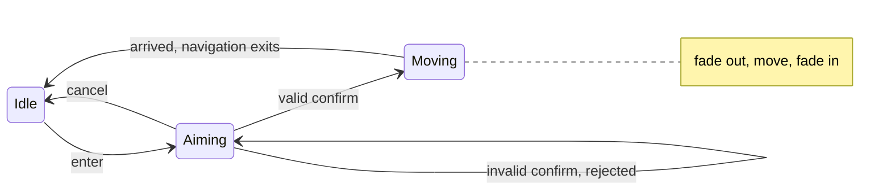
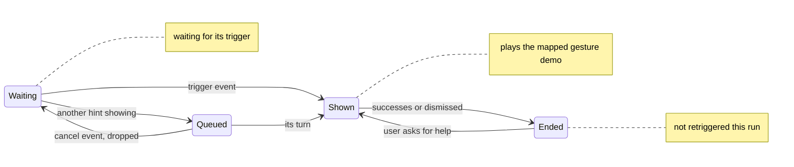

# Navigation and Guidance

## 1. Introduction

### 1.1 Purpose

This doc designs two feature modules of the UI library. **Navigation** lets a user move around a room and return to an overview, and **Guidance** teaches the main interactions when the user needs them. Each module has its own part of this doc. Both build on the [library core architecture design doc](Core_Architecture_Design.md).

### 1.2 Stories

**Story 5. Navigate the room.** As a user, I want to move around the room comfortably, so I can inspect my design from different viewpoints.

- I can move to a chosen location and change my viewing direction.
- Navigation is understandable and comfortable to use.
- I can return to a useful overview of the room.

**Story 6. Learn how to use the experience.** As a first-time user, I want guidance on the main interactions, so I can get started without much help.

- I can discover how to perform the core tasks.
- (Optional) Guidance is available when I need it and doesn't prevent me from using the experience.

### 1.3 Scope

**In scope:**

- Teleporting to a chosen spot, snap turning, and returning to an overview
- Finding viewpoints in any level, including the overview
- Showing hints when the user starts a related activity or asks for help
- Hints for any module's interactions, not only navigation

**Out of scope:**

- Smooth movement and other movement types, which can be added later as new providers
- Saving which hints a user has seen between sessions, which belongs to the application
- Writing the hint content for a specific app, which belongs to whoever integrates the library

## 2. Constraints and Assumptions

### 2.1 Constraints

- Unreal Engine 5.8, C++ (C++20), Epic C++ Coding Standard.
- Meta Quest headsets, hand tracking as the primary input, through the Interaction SDK.
- The Interaction SDK for Unreal has no locomotion, so Navigation is built by us on Unreal's own features.
- Both modules depend only on the library core.

### 2.2 Assumptions

- Teleport is the movement type. Snap turn is the only turning type.
- Hints appear only when the user starts a related activity or asks for help.
- The A/B gesture mapping is chosen before a session and doesn't change during it.
- Guidance is disabled during study sessions, since the administrator reads instructions aloud.
- Hint state is kept in memory for the run only.
- Both free teleport anywhere on the floor and teleport to fixed spots are supported, and an app can allow either or both.
- The overview is a placed anchor flagged by the developer.
- The teleport aim uses an arc.

### 2.4 What these modules use from the core

Besides intents and the event channel, these modules rely on two core features added for them:

- **Aim pose per hand** (core story CORE-8). Navigation draws its arc from the hand's aim pose and hides it when the core reports the hand isn't tracked.
- **The gesture mapped to an intent** (core story CORE-9). Guidance asks the router which gesture fires a hint's intent under the active mapping, and plays that gesture's demonstration.

Both modules' events also feed the TaskValidator, which listens from the application layer. For example, a "reach the far corner" task can start on `Navigation.Entered` and succeed on a `MoveCompleted` within a set distance of a marker.

# Part A: Navigation

## 3. Navigation Approach

### 3.1 Teleport and turning

The user moves by teleporting. They aim at a spot, confirm, and the view cuts there behind a short fade. Teleporting shows no continuous motion, so there's no mismatch between what the eyes see and what the inner ear feels, which is the main cause of discomfort in VR. The trade-off is that teleporting can briefly disorient, which the overview and short, predictable fades help with.

Turning uses snap turns, which rotate the view in fixed steps. Snap turns can feel choppy, so the step size is configurable, and a smaller step such as 30 degrees feels smoother than larger jumps. Continuous turning is left out to keep Navigation simple, and because continuous rotation is one of the strongest causes of discomfort. Standing users can also simply turn their body, which needs no turning feature at all.

### 3.2 Movement providers and one rig owner

In Unreal, the user is represented in the world by a **rig**, which is the pawn together with its camera and tracked hands. Moving the user means moving the rig. Each way of moving (teleport, snap turn, go to a viewpoint) is a separate **provider**, and only one component, the **rig owner**, is allowed to actually move the rig. Providers work out where the user should go and ask the rig owner to move them, but they never move the rig themselves. This follows Unity's XR Interaction Toolkit, where a single mediator gives movement providers access to the user's body, and Meta's Unreal locomotion sample, which switches between locomotion components through a shared interface. Two providers can never fight over the user's position, and a new movement type is a new provider with no edits to the others.

When a request arrives while a move is still in progress, the newest request replaces any waiting one, and "go to overview" cancels whatever is in progress. A plain queue would turn an accidental double confirm into two teleports, and rejecting outright would feel like input was ignored. Every request's outcome (applied, replaced or rejected) is published as an event.

### 3.3 Where the user may go

A spot is valid if it lies on the level's navigation mesh or on a surface tagged as navigable, and there's room for the user to stand there without overlapping furniture. The navigation mesh is Unreal's own way to describe walkable floor, and Epic's VR template uses it for teleport targets, so most levels already have one. Tags cover levels that don't. Free teleport and fixed viewpoints both work, so an app can allow either or both.

### 3.4 Viewpoints and the overview

Viewpoints are anchors a developer places in the level. Navigation finds them automatically instead of needing a list, because the library can't assume every app will maintain one. One anchor is flagged as the overview. If none is flagged, the editor warns and Navigation falls back to a view computed from the room's bounds, which is the only case where the library chooses a view itself.

For example, a room planner app might place anchors at the door, beside a table, and in a high corner flagged as the overview. A showroom app might place only an overview anchor. Both work with no code changes.

### 3.5 Entering navigation

Navigation is entered deliberately with its own intent, rather than always listening for a confirm. While it's active, its input context takes priority, so the same pinch that grabs an object elsewhere confirms a teleport here. Meta's hand locomotion guidance takes the same approach, gating locomotion behind a deliberate gesture so it doesn't collide with other interactions. The user leaves navigation by cancelling or after a move completes, and the other modules' gestures work again.

## 4. Navigation Design

### 4.1 Components

- The **navigation component** is added to the user's pawn and is the rig owner. It receives Navigation's intents, runs the active provider, moves the user, plays the fade and publishes events.
- The **providers** are teleport, snap turn and go to viewpoint. Teleport aims, checks the spot, shows the marker and moves on confirm. Snap turn rotates by a fixed angle around the user's head rather than the play area's center. Go to viewpoint moves the user to an anchor's position and facing.
- A **viewpoint anchor** is an actor placed in the level with a name, a position, a facing and an "is overview" flag.
- The **viewpoint registry** is a world subsystem that finds every anchor when the level loads and answers "where is the overview?"
- The **presenters** are the aim arc, the destination marker (one look for valid, another for invalid) and the fade. They're separate from the logic, so an app can restyle them.

A teleport moves through the states below. Leaving aiming any way other than a valid confirm returns to idle without moving.



### 4.2 Intents consumed

| Intent                                        | What it does                                                |
|-----------------------------------------------|-------------------------------------------------------------|
| `Navigation.Enter`                            | Start aiming, and Navigation's input context becomes active |
| `Navigation.Confirm`                          | Teleport to the aimed spot, if valid                        |
| `Navigation.Cancel`                           | Stop aiming without moving                                  |
| `Navigation.TurnLeft`, `Navigation.TurnRight` | Snap turn by the configured angle                           |
| `Navigation.GoToOverview`                     | Move to the overview anchor from anywhere                   |

Which gesture fires each one is set by the active mapping, not by Navigation.

### 4.3 Events published

| Event (after `HTUI.Event.Navigation.`) | When                                         | Key payload fields                                 |
|----------------------------------------|----------------------------------------------|----------------------------------------------------|
| `Entered` / `Exited`                   | Aiming starts or ends                        | Hand                                               |
| `MoveRequested`                        | A confirm or overview request arrives        | Request ID, provider, target                       |
| `MoveCompleted`                        | The user has arrived                         | Request ID, from, to, provider, anchor name if any |
| `MoveRejected`                         | A request is replaced or the spot is invalid | Request ID, reason                                 |
| `Turned`                               | A snap turn finishes                         | Angle                                              |
| `ViewpointChanged`                     | The user arrives at an anchor                | Anchor name, whether it's the overview             |

### 4.4 Configuration

Navigation has one settings asset. Every value has a default, so Navigation works without one. These values are subject to change.

| Setting                             | Default               |
|-------------------------------------|-----------------------|
| Snap turn angle                     | 30 degrees            |
| Fade duration                       | 0.15 s out, 0.15 s in |
| Allow free teleport / allow anchors | Both on               |
| Navigable surface tag               | `Navigable`           |
| Clearance radius around the user    | 30 cm                 |
| Maximum teleport distance           | 10 m                  |

## 5. Navigation Examples

### 5.1 Teleporting beside the table

1.  The user performs the gesture mapped to `Navigation.Enter`. Navigation activates its input context and broadcasts `Entered`.
2.  They point at the floor beside a table. The arc follows their hand's aim pose. The spot is on the navigation mesh with room to stand, so the marker shows valid.
3.  They perform the confirm gesture. Navigation broadcasts `MoveRequested`, fades out, moves the user, fades in, then broadcasts `MoveCompleted` and `Exited`.
4.  Their gestures grab objects again, because Navigation's context is no longer active.

### 5.2 Aiming inside a cabinet

1.  While aiming, the user points at the floor inside a supply cabinet.
2.  The spot is on the floor, but a standing user would overlap the cabinet, so the marker shows invalid.
3.  They confirm anyway. Navigation broadcasts `MoveRejected` with the reason "invalid target" and stays in aiming, so they can simply point elsewhere.

### 5.3 Losing the hand while aiming

1.  The user is aiming when their hand drifts out of the headset's view.
2.  With no aim pose, the arc and marker hide. Nothing moves.
3.  If they had started the confirm gesture, it arrives as a cancelled intent, and Navigation ignores it.
4.  When the hand returns, the arc reappears, and they can confirm or cancel as usual.

### 5.4 Returning to the overview mid-move

1.  The user confirms a teleport to the far wall, and the fade begins.
2.  Before it finishes, they perform the gesture for `Navigation.GoToOverview`.
3.  The overview request overrides the move in progress. The far-wall request is reported as `MoveRejected` with the reason "replaced," and the user arrives at the overview, followed by `ViewpointChanged`.

### 5.5 A level with no overview flagged

1.  A developer drops Navigation into a new showroom level and places two anchors, but flags neither as the overview.
2.  The editor shows a warning that the level has no overview anchor.
3.  If they run it anyway, "go to overview" uses a view computed from the room's bounds, placed above and behind the room's center and looking toward it.
4.  Flagging one anchor removes the warning and the fallback.

## 6. Navigation API

These are brief sketches of Navigation's public types, written to help the team implement the stories in Section 11. They are not representative of the final implementation, and names and signatures will change as the stories are built. Names use the `HTUI` prefix, and the APIs are C++ only.

``` cpp
UENUM() enum class EHTUIMoveOutcome : uint8 { Applied, Replaced, Rejected };

USTRUCT() struct FHTUIMoveRequest
{
    GENERATED_BODY()
    UPROPERTY() FGuid RequestId;
    UPROPERTY() FName Provider;          // Teleport, SnapTurn, GoToViewpoint
    UPROPERTY() FTransform Target;
    UPROPERTY() bool bOverrides = false; // true for go-to-overview
};

// The rig owner. Added to the user's pawn.
UCLASS() class HTUINAVIGATION_API UHTUINavigationComponent : public UActorComponent
{
    GENERATED_BODY()
public:
    // Requests from the application; intents arrive through the core.
    FGuid RequestMoveTo(const FTransform& Target);
    FGuid RequestGoToViewpoint(FName AnchorName);
    FGuid RequestGoToOverview();
    void RequestSnapTurn(bool bRight);

    void SetSettings(UHTUINavigationSettings* Settings);
    bool IsAiming() const;

private:
    void Submit(const FHTUIMoveRequest& Request);   // latest wins; overrides cancel
    TArray<TObjectPtr<UHTUIMovementProvider>> Providers;
};

// One subclass per way of moving.
UCLASS(Abstract) class HTUINAVIGATION_API UHTUIMovementProvider : public UObject
{
    GENERATED_BODY()
public:
    virtual void Begin(UHTUINavigationComponent* Owner);
    virtual void Tick(float DeltaSeconds);
    virtual void End();
};

// Placed in levels.
UCLASS() class HTUINAVIGATION_API AHTUIViewpointAnchor : public AActor
{
    GENERATED_BODY()
public:
    UPROPERTY(EditInstanceOnly) FName AnchorName;
    UPROPERTY(EditInstanceOnly) bool bIsOverview = false;
};

UCLASS() class HTUINAVIGATION_API UHTUIViewpointRegistry : public UWorldSubsystem
{
    GENERATED_BODY()
public:
    const AHTUIViewpointAnchor* FindAnchor(FName AnchorName) const;
    FTransform GetOverview() const;      // flagged anchor, or the computed fallback
};
```

# Part B: Guidance

## 7. Guidance Approach

### 7.1 Two triggers, starting an activity or asking

A hint appears when the user starts an activity it relates to, or when they ask for help. Onboarding research calls this "pull" help, meaning help that appears when a signal shows the user could use it, such as starting a related action, instead of all at once at launch. Users often skip up-front tutorials, and information shown out of context is hard to remember when it's needed. Asking for help uses a familiar button in view rather than a learned gesture, since people ask when they're stuck. Triggers based on idle time or repeated failure were considered and left out to keep the module simple. They can be added later as new trigger types.

### 7.2 Hints are data, started by events

Each hint is a data asset naming the event that starts it, the event that counts as a success, and what to show. Guidance listens on the event channel for those events, so it can teach any module's interactions without that module knowing Guidance exists, and an integrator can add hints for their own modules without code. The cost is that a hint can only react to something a module announces. A module that publishes no events can't be taught.

For example, the manipulation module broadcasts `RotateModeEntered` when the user switches to rotating. A "rotate an object" hint names that event as its trigger and `Rotated` as its success. Manipulation's code is unchanged.

### 7.3 Ending a hint and one at a time

A hint ends after a set number of successes, two by default, because learners often succeed once by accident. The user can also dismiss it. Only one hint shows at a time. If another is triggered meanwhile, it waits and shows next, so hints never stack on top of each other.

A waiting hint can go stale if the user moves on before its turn. Each hint can therefore name a cancel event, such as `Object.CatalogClosed` for the "add an object" hint. If that event fires while the hint is waiting, the hint is dropped from the line without ending, so it can trigger again the next time the user starts that activity. A hint that has ended isn't shown again during the run unless the user asks for help.

### 7.4 Showing the gesture that's actually mapped

A hint names an intent, such as `Object.Grab`, not a gesture. When it's shown, Guidance asks the core which gesture fires that intent in the active mapping, and plays that gesture's looping hand demonstration. Meta's onboarding guidelines recommend teaching gestures with looping 3D hand animations, since hands give no physical cues. Under mapping A the grab hint shows a pinch, and under mapping B it shows a fist, from the same hint asset.

### 7.5 Staying out of the way

Hints never capture input. They have no collision and can't be selected, so a hint never blocks grabbing an object behind it. Hints appear in a **hint dock**, a consistent spot low in the user's view that gently follows their head, rather than popping up wherever the action is. A spot pinned to the corner of the headset's screen was considered, but in VR that kind of fixed display sits in peripheral vision, where it's hard to read and easy to miss, so the dock follows with a slight delay instead. A hint can also add an optional highlight on the object it's about. Guidance is disabled during study sessions, where the administrator reads instructions aloud. Which hints have ended is kept in memory and exposed through the API, so an app that wants to remember them between sessions can save and restore that state itself.

## 8. Guidance Design

### 8.1 Components

- The **Guidance subsystem** loads the hint assets, listens for their trigger, success and cancel events, keeps the waiting line of hints, and tracks which have ended this run.
- **Hint assets** describe one hint each, and are written by whoever integrates the library.
- The **presenters** are the hint dock with its short text and a looping hand demonstration of the mapped gesture, plus an optional highlight on the object the hint is about. All are non-interactive.
- The **gesture demo library** is a data asset pairing each gesture name (`Pinch`, `Fist`, `PalmUp`, `WristButton`) with its looping hand animation.

Every hint moves through the states below.



### 8.2 What a hint asset holds

| Field                   | Example (rotate hint)                          |
|-------------------------|------------------------------------------------|
| Hint ID                 | `Hint.Manipulation.Rotate`                     |
| Trigger event           | `HTUI.Event.Manipulation.RotateModeEntered`    |
| Success event           | `HTUI.Event.Manipulation.Rotated`              |
| Cancel event (optional) | `HTUI.Event.Manipulation.RotateModeExited`     |
| Successes to end        | 2                                              |
| Intent to demonstrate   | `Manipulation.Rotate`                          |
| Text                    | "Turn your hand to rotate the object."         |
| Highlight the object    | Yes, using the object in the trigger's payload |
| Priority                | Used only to order waiting hints               |

### 8.3 Intents consumed

| Intent             | What it does                                                                                                 |
|--------------------|--------------------------------------------------------------------------------------------------------------|
| `Guidance.Help`    | Replays the hint for what the user is doing now. If nothing is active, it shows the most recently ended hint |
| `Guidance.Dismiss` | Ends the visible hint without counting a success                                                             |

### 8.4 Events published

| Event (after `HTUI.Event.Guidance.`) | When                                                       |
|--------------------------------------|------------------------------------------------------------|
| `HintShown`                          | A hint appears, with whether it was triggered or requested |
| `HintCompleted`                      | A hint reaches its success count                           |
| `HintDismissed`                      | The user dismisses it                                      |

### 8.5 Configuration

| Setting                  | Default                                                                   |
|--------------------------|---------------------------------------------------------------------------|
| Guidance enabled         | On. The application can switch it off, and it's off during study sessions |
| Default successes to end | 2                                                                         |
| Gesture demo library     | The library's default animations                                          |
| Hint assets to load      | All hint assets in a configured folder                                    |

## 9. Guidance Examples

### 9.1 Adding the first object

1.  A first-time user opens the object catalog. The object lifecycle module broadcasts `Object.CatalogOpened`.
2.  The "add an object" hint is triggered. It shows in the hint dock with the looping demo for the gesture mapped to `Object.Add`.
3.  The user adds a chair, and the module broadcasts `Object.Placed`. That's one success.
4.  They add a cart. That's two successes, so the hint ends and `HintCompleted` is broadcast.
5.  Opening the catalog again later doesn't bring the hint back.

### 9.2 Two hints at once

1.  The "teleport" hint is showing because the user just entered navigation.
2.  They cancel and open the catalog, which triggers the "add an object" hint. The teleport hint is still showing, so the new hint waits in line.
3.  Before the teleport hint ends, they close the catalog and start rotating a chair. The catalog's `Object.CatalogClosed` event is the waiting hint's cancel event, so the "add an object" hint is dropped rather than shown out of context.
4.  They had already finished the rotate hint earlier in the run, so nothing new is queued.
5.  Later they open the catalog again. The "add an object" hint never ended, so it triggers again and shows in the dock.

### 9.3 Asking for help after a hint has ended

1.  Earlier, the user finished the rotate hint. Now, mid-rotation, they can't remember the gesture.
2.  They press the help button on the wrist toolkit, which the mapping binds to `Guidance.Help`.
3.  Rotation is the active activity, so the rotate hint replays even though it had ended.

### 9.4 The same hint under mapping B

1.  The session was set up with mapping B, where grabbing is a closed fist.
2.  The user selects an object and the "grab" hint is triggered.
3.  Guidance asks the core which gesture fires `Object.Grab` and gets `Fist`, so the hint plays the fist demonstration. Under mapping A, the same hint asset would show a pinch.

### 9.5 A study task with Guidance off

1.  The administrator starts a session with Guidance switched off and reads the gesture instructions aloud.
2.  Every module still broadcasts its events, but Guidance doesn't show anything.
3.  No other module behaves differently, so the task measures the gestures, not the hints.

## 10. Guidance API

These are brief sketches of Guidance's public types, written to help the team implement the stories in Section 11. They are not representative of the final implementation, and names and signatures will change as the stories are built. Names use the `HTUI` prefix, and the APIs are C++ only.

``` cpp
// Hints always show in the hint dock. bHighlightObject adds the optional highlight.

UCLASS() class HTUIGUIDANCE_API UHTUIHintAsset : public UPrimaryDataAsset
{
    GENERATED_BODY()
public:
    UPROPERTY(EditDefaultsOnly) FGameplayTag HintId;
    UPROPERTY(EditDefaultsOnly) FGameplayTag TriggerEvent;
    UPROPERTY(EditDefaultsOnly) FGameplayTag SuccessEvent;
    UPROPERTY(EditDefaultsOnly) FGameplayTag CancelEvent;      // optional
    UPROPERTY(EditDefaultsOnly) int32 SuccessesToEnd = 2;
    UPROPERTY(EditDefaultsOnly) TObjectPtr<const UInputAction> IntentToShow;
    UPROPERTY(EditDefaultsOnly) FText Text;
    UPROPERTY(EditDefaultsOnly) bool bHighlightObject = false;
    UPROPERTY(EditDefaultsOnly) int32 Priority = 0;
};

UCLASS() class HTUIGUIDANCE_API UHTUIGuidanceSubsystem : public UWorldSubsystem
{
    GENERATED_BODY()
public:
    void SetEnabled(bool bEnabled);                 // per session
    void ShowHelp();                                // same as the Help intent
    void DismissCurrent();

    // In-memory state; the application decides whether to save it.
    TArray<FGameplayTag> GetEndedHints() const;
    void SetEndedHints(const TArray<FGameplayTag>& Hints);
    void ResetHints();
};
```

For example, an app that wants returning users to skip hints they've already finished calls `GetEndedHints()` when the user quits, saves the list its own way, and passes it to `SetEndedHints()` next time.

# Delivery

## 11. Epic and User Stories

**Navigation and Guidance epic.** As a user, I want to move around the room comfortably and learn the main interactions when I need them, so that I can review my design without help from someone else.

This epic starts once the core's event channel, gesture bridge and intents exist (CORE-1 to CORE-3). Stories are ordered so each builds on the one before.

**NAV-1. Return to the overview.** As a user, I want to jump to an overview of the room, so that I can see the whole design at once.

- [ ] Given an anchor flagged as the overview, when `Navigation.GoToOverview` completes, then the user fades out, arrives at the anchor's position and facing, and fades in.
- [ ] `MoveCompleted` and `ViewpointChanged` are broadcast.

**GUI-1. Show a hint when its trigger event fires.** As a first-time user, I want a hint when I start something new, so that I know what to do.

- [ ] Given a hint asset whose trigger is `Navigation.Entered`, when that event is broadcast, then the hint's text appears in the hint dock.
- [ ] The hint has no collision and never blocks another module's input.

**NAV-2. Aim and check a spot.** As a user, I want to see where I'll land, so that I can choose a good spot.

- [ ] Given Navigation is entered, then an arc follows the hand's aim pose and a marker shows on the floor.
- [ ] Given the spot is off the navigation mesh, untagged, or lacks room to stand, then the marker shows invalid.
- [ ] Given the hand isn't tracked, then the arc and marker hide.

**NAV-3. Teleport on confirm.** As a user, I want to move to the spot I chose, so that I can inspect the design from there.

- [ ] Given a valid spot, when `Navigation.Confirm` completes, then the user moves there behind a fade and Navigation exits.
- [ ] Given an invalid spot, then `MoveRejected` is broadcast and aiming continues.
- [ ] Given a cancelled confirm intent, then nothing moves.

**GUI-2. End hints after successes, one at a time.** As a user, I want hints to go away once I've got it, and not pile up, so that they don't get in my way.

- [ ] Given a hint with 2 successes to end, when its success event fires twice, then it hides and `HintCompleted` is broadcast.
- [ ] Given a hint is showing, when another is triggered, then the second waits and shows after the first ends.
- [ ] An ended hint doesn't reappear from its trigger during the run.
- [ ] Given a hint is waiting, when its cancel event fires, then it's dropped from the line without ending, and can trigger again later.

**NAV-4. Snap turn.** As a user, I want to turn without physically turning, so that I can look around when seated or tethered.

- [ ] Given snap turning, when `Navigation.TurnRight` completes, then the view rotates by the configured angle around the user's head.
- [ ] The angle comes from the settings asset.

**NAV-5. Handle requests mid-move.** As a user, I want a quick second action to behave predictably, so that I don't end up somewhere I didn't choose.

- [ ] Given a move is in progress, when a new move is requested, then it replaces any waiting request, and the replaced one is reported as `MoveRejected` with reason "replaced."
- [ ] Given a move is in progress, when go-to-overview is requested, then the move is cancelled and the user goes to the overview.

**GUI-3. Ask for help.** As a user, I want to bring a hint back when I'm stuck, so that I can recover on my own.

- [ ] Given the user is in an activity with a hint, when `Guidance.Help` completes, then that hint shows even if it already ended.
- [ ] `Guidance.Dismiss` hides the current hint without counting a success.

**NAV-6. Find viewpoints automatically.** As a developer, I want anchors found without a list, so that Navigation works in any level.

- [ ] Given anchors placed in a level, then the registry finds all of them on load.
- [ ] Given no anchor or several are flagged as the overview, then the editor warns. With none, the overview falls back to a view computed from the room's bounds.

**GUI-4. Show the mapped gesture.** As a study participant, I want hints to show the gesture I'm actually using, so that the hint matches my condition.

- [ ] Given mapping B binds `Object.Grab` to `Fist`, then the grab hint plays the fist demonstration.
- [ ] The same hint asset under mapping A plays the pinch demonstration.

**GUI-5. Switch Guidance off and expose its state.** As a study administrator or developer, I want to turn hints off for a session and read or restore which have ended, so that the study and the app each control them.

- [ ] Given Guidance is switched off, then no hint shows, and every other module behaves the same.
- [ ] `GetEndedHints`, `SetEndedHints` and `ResetHints` read, restore and clear the run's state.

## 12. Testing

**Unit tests** (logic in isolation):

- Request handling keeps the latest request, lets the overview override, and reports every outcome (NAV-5)
- Spot checks accept the navigation mesh and tagged surfaces, and reject spots blocked by furniture (NAV-2)
- The viewpoint registry finds anchors, warns on zero or several overviews, and computes a fallback (NAV-6)
- The hint queue shows one hint at a time in priority order, drops cancelled hints, and never retriggers ended ones (GUI-2)
- The mapped gesture lookup resolves the same hint to different demos under A and B (GUI-4)

**Integration tests** (a test level, intents and events injected through the core):

- Injecting enter, aiming at a valid spot and confirming moves the user, and `MoveCompleted` then `Exited` are broadcast
- Injecting a cancelled confirm moves nothing
- Broadcasting `Object.CatalogOpened` once and `Object.Placed` twice shows the hint once and ends it
- Broadcasting `Object.CatalogClosed` while the catalog hint waits drops it without ending it
- With Guidance off, the same sequences show no hint and Navigation behaves identically

**In-headset checks:**

- Teleport and snap turn feel comfortable for several team members, and the fade length and snap angle are tuned
- The arc and marker are readable at the maximum distance
- Hints in the dock are readable, easy to find, and don't block objects behind them

## 13. Risks

| Risk                                                                                               | Impact                                                   | Mitigation                                                                                 |
|----------------------------------------------------------------------------------------------------|----------------------------------------------------------|--------------------------------------------------------------------------------------------|
| Teleporting disorients some users                                                                  | Users lose track of where they are                       | Short, consistent fades and a one-step return to the overview                              |
| Levels without a navigation mesh or tags                                                           | Nowhere counts as valid                                  | Editor warning, and anchors still work without either                                      |
| The core's aim pose and mapping queries (CORE-8, CORE-9) arrive later than these modules need them | Navigation can't aim; hints can't show the right gesture | Both are small. Schedule them before NAV-2 and GUI-4, and stub them for testing until then |
| A module publishes no events for an activity                                                       | Guidance can't teach it                                  | Each module's design doc lists its events, and hint authors pick from those                |
| Hints shown during study tasks change results                                                      | Skewed data                                              | Guidance is disabled for study sessions                                                    |

## 14. References

- [Library core architecture design doc](Core_Architecture_Design.md)
- [Meta: Locomotion best practices](https://developers.meta.com/horizon/design/locomotion-best-practices/)
- [Meta: Artificial locomotion input maps](https://developers.meta.com/vr/design/locomotion-input-maps/)
- [Meta: Unreal Locomotion sample](https://developers.meta.com/vr/documentation/unreal/unreal-sample-locomotion)
- [Meta: Hands onboarding best practices](https://developers.meta.com/horizon/design/hands-onboarding-best-practices/)
- [Unity: XR Interaction Toolkit locomotion](https://docs.unity3d.com/Packages/com.unity.xr.interaction.toolkit@3.2/manual/locomotion)
- [Epic: VR Template](https://dev.epicgames.com/documentation/unreal-engine/vr-template-in-unreal-engine)
- [Nielsen Norman Group: Onboarding tutorials vs. contextual help](https://www.nngroup.com/articles/onboarding-tutorials/)
- [Ultraleap: Tutorials, hints, and help](https://docs.ultraleap.com/xr-guidelines/Getting%20started/tutorials_hints_tip.html)
