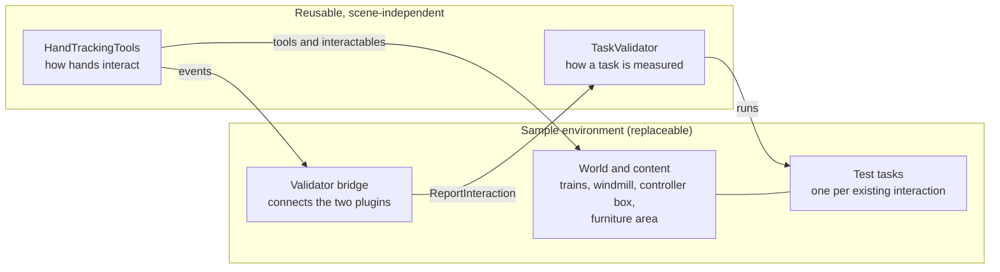
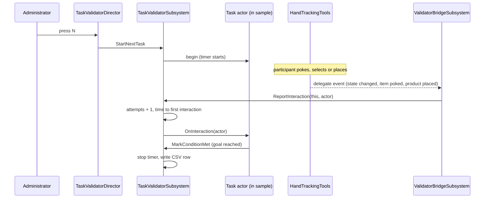

# Plugin Architecture: Sample, Hand Tracker and Validator

This project is three separate things that work together:

| Part | What it is | Where it lives |
| --- | --- | --- |
| **The sample** (`HandsTrainSample`) | A sample environment. A world, content and tasks that people can do with their hands. | `Source/HandsTrainSample`, `Content/` |
| **Hand Tracking Tools** (`HandTrackingTools`) | The hand tracker. How hands touch, point at and select things. | `Plugins/HandTrackingTools` |
| **Task Validator** (`TaskValidator`) | The validator. How a task is timed, counted, judged and logged. | `Plugins/TaskValidator` |

The two plugins can be used without the sample, and without each other. This document explains why they are separate, what each one owns, how they cooperate at runtime, and how to put your first test task into the sample.

## Contents

1. [The sample is a sample environment](#1-the-sample-is-a-sample-environment)
2. [Why the three parts are separate](#2-why-the-three-parts-are-separate)
3. [What each part owns](#3-what-each-part-owns)
4. [How they work together at runtime](#4-how-they-work-together-at-runtime)
5. [Tutorial: implement your initial test task as an existing task within the sample](#5-tutorial-implement-your-initial-test-task-as-an-existing-task-within-the-sample)
6. [Adding your own task](#6-adding-your-own-task)
7. [Using the plugins in another project](#7-using-the-plugins-in-another-project)
8. [What moved, and what that does to existing content](#8-what-moved-and-what-that-does-to-existing-content)
9. [Rules that keep the separation](#9-rules-that-keep-the-separation)

## 1. The sample is a sample environment

The Unreal project in this repository is not the product. It is a **sample environment**, a ready-made place to run hand tracking interactions, and it is designed to **"implement your initial test task as an existing task within the sample."**

In plain terms:

- **The sample already contains things a participant can do.** The poke buttons on the controller box drive the train. A ray selects the windmill and the crossing. The wrist toolkit and menu place, select, move, rotate, resize and remove furniture in a marked floor area. Hands are tracked and drawn. None of that has to be built for a study.
- **A test task is one of those existing things, wrapped so it can be measured.** You don't build a new scene for your first task. You pick an interaction the sample already has ("press the controller box button", "select the windmill", "place a chair in the marked area"), give it an instruction, and let the validator time it and count attempts. The task lives in the sample because only the sample knows what "done" means for its own content.
- **The sample is replaceable.** A different environment (another scene, another set of objects) gets the same hand tracker and the same validator, and only supplies its own tasks.

So the question "where does my task go?" has one answer: **in the sample, as a task that uses the sample's existing content.** The two plugins provide the machinery and know nothing about trains or furniture.

## 2. Why the three parts are separate

1. **The interaction method isn't decided.** The study needs to compare ways of interacting (poke, ray, pinch, wrist UI). The validator therefore cannot know about any one of them. It only needs to be told "the participant just interacted with this actor."
2. **The tracker should be reusable.** The open-source hand tracking UI library is useful to people who have no study, no trains and no CSV. Pulling the tracker out lets them take just that.
3. **The validator should be reusable.** The study software must work with whatever scene the study uses next. Because it has no XR dependency and no content dependency, it can validate any interaction in any project.
4. **The sample can then change freely.** Replacing the trains with a different scene, or adding a new task, touches only the sample. Neither plugin is rebuilt or retested.
5. **Mistakes show up at compile time.** If a plugin ever started depending on the sample or on the other plugin, the build would fail, because the plugin's `Build.cs` doesn't list that dependency. The separation is enforced, not just agreed.
6. **You can test each part alone.** The validator runs on a desktop with console commands and no headset. The tracker's tools run without a study session.

## 3. What each part owns

### 3.1 HandTrackingTools (the hand tracker)

Module `HandTrackingTools`, runtime. It depends on the Meta XR plugin (`OculusXR`) and Epic's `OpenXRHandTracking`, and on nothing else of ours.

| Area | Classes |
| --- | --- |
| **Tools** | `AInteractableTool`, `AFingerTipPokeTool` (near field), `ARayTool` and `URayToolViewHelper` (far field), `AInteractableToolsManager`, `InteractableToolsInputRouter` |
| **Interactables** | `AInteractable` with proximity, contact and action zones, `ACollidableInteractable`, `AInteractableButton`, `UColliderZone`, `UButtonTriggerZone`, `ABoneCapsuleTriggerLogic`, `UButtonMeshHelper`, `USelectionCylinderHelper` |
| **Hands** | `AHandsVisualizationSwitcher`, `AHandsActiveChecker`, `PinchStateModule` |
| **Helpers** | `HandPointerUtils` (find a hand, bone positions, pointing ray, pinch distance) |
| **Hand UI** | `AWristToolkit` (five poke items on the back of one hand), `AButtonPanel` (eight poke buttons) |

What it gives you: events. When a participant does something, an actor broadcasts a delegate (`OnInteractableStateChanged`, `OnItemActivated`, `OnButtonPressed`). It never asks who is listening.

### 3.2 TaskValidator (the validator)

Modules `TaskValidator` (runtime, no XR dependency), `TaskValidatorEditor` (editor only, adds the **Task Validator** tab to Place Actors) and `TaskValidatorDemo` (optional placeholder pinch grab and cube).

| Piece | Role |
| --- | --- |
| `UTaskValidatorSubsystem` | The core. Session, participant ID, the running task, timer, counters, CSV. |
| `AValidatorTask` | Base class for one study task placed in a level. |
| `ATargetZoneTask` | "Put the object in this box." |
| `AEventTask` | "Done when this event happens", or when the participant interacts with a chosen actor. |
| `ATaskValidatorDirector` | One per level. Starts the session, gives the administrator keys and an overlay. |

What it gives you: one input call, `UTaskValidatorSubsystem::ReportInteraction(this, Actor)`, and a CSV with success, attempts, time on task and time to first interaction. See [validator/DESIGN.md](validator/DESIGN.md) and [validator/GUIDE.md](validator/GUIDE.md).

### 3.3 HandsTrainSample (the sample environment)

Module `HandsTrainSample`, the game module. It depends on both plugins and is the only thing that does.

| Area | Classes |
| --- | --- |
| **World content** | `ATrainTrack`, `ATrackSegment`, `ATrainParent`, `ATrainLocomotive`, `ANormalTrainCar`, `ACowCar`, `ATrainCrossing`, `AWindmill`, `AControllerBox` |
| **Furniture task content** | `AFurnitureProduct`, `UProductCatalogAsset`, `UProductHistorySubsystem`, `AProductPlacer`, `AProductEditTools`, `AWristMenu` |
| **Test tasks** | `AProductPlacementTask` (the sample's initial test task) |
| **The bridge** | `UValidatorBridgeSubsystem` |

It also owns `Content/` (the map, Blueprints, meshes) and the project configuration.

## 4. How they work together at runtime

The hand tracker and the validator never call each other. The sample's bridge sits between them.

Step by step:

1. **Setup.** The level contains a `TaskValidatorDirector` and one or more task actors. The bridge needs no placing: it is a world subsystem and exists in every game world.
2. **Start.** The administrator reads the instruction aloud and presses **N**. The validator starts the timer and marks the task active.
3. **Interaction.** The participant touches something. A tool in HandTrackingTools raises an event on the thing touched. The bridge is already listening, and turns it into `ReportInteraction`. The bridge listens to these events:

   | Event (from HandTrackingTools or the sample) | Counts as an attempt when |
   | --- | --- |
   | `AInteractable::OnInteractableStateChanged` | the interactable enters the action state (a press or select). The bridge reports the **placed owner** of the interactable (see below) |
   | `AWristToolkit::OnItemActivated` | any toolkit item is poked |
   | `AButtonPanel::OnButtonPressed` | any panel button is pressed |
   | `AProductPlacer::OnSelectionChanged` | a product is selected (clearing does not count) |
   | `UProductHistorySubsystem::OnEditApplied` | a product is placed, removed, moved, rotated or resized (undo does not count) |

4. **Counting.** The validator adds one attempt, sets time to first interaction on the first one, and calls the task's `OnInteraction`. Attempts are counted before the task is asked, so the attempt that completes a task is always included.
5. **Completion.** The task decides when it is done and calls `MarkConditionMet()`. The validator stops the timer and appends one CSV row. Pressing **X** instead records the task as abandoned.
6. **Outside a study** nothing happens. With no running task, `ReportInteraction` is ignored, so the bridge is harmless in normal play.

**Which actor is reported.** The sample creates its interactables at runtime and attaches them to an actor placed in the level: the windmill and the crossing each spawn a hidden logic actor, and the controller box spawns its eight buttons. A task can only point at actors that exist in the level, so the bridge reports the root of the attachment chain. In practice: touching the windmill reports the **Windmill**, the crossing reports the **TrainCrossing**, and pressing any controller box button reports the **ControllerBox**.

### Why a bridge, not direct calls

If HandTrackingTools called the validator, every user of the tracker would need the validator. If the validator knew about the tracker's classes, it couldn't validate any other interaction method. The bridge keeps both facts true. It is about 130 lines, it lives in the sample, and a different project writes its own.

## 5. Tutorial: implement your initial test task as an existing task within the sample

You will pick an interaction the sample already has, wrap it as a validator task, run it on a desktop, and read the CSV. Two ways are shown. Both use the same steps for the level and the Director.

Do the setup in the [Software Setup Strategy](SOFTWARE_SETUP_STRATEGY.md#5-tutorial-fresh-clone-to-running-on-a-quest) first, up to step 6. All of this works without a headset.

### 5.1 Prepare the level

1. Open `HandsInteractionTrainMap`. **File → Save Current Level As…** and save a copy named `ValidatorTestMap`, so the sample map stays clean.
2. Open **Window → Place Actors**. There is now a **Task Validator** tab.
3. Drag a **Task Validator Director** into the level (its position doesn't matter). In **Details**, set **Participant Id** to `P01` and keep **Show Admin Overlay** ticked.

### 5.2 Option A: a selection task on something the sample already has

Example: "Select the windmill." The windmill is already a ray-selectable interactable.

1. Drag an **Event Task** into the level.
2. In **Details**:

   | Setting | Value |
   | --- | --- |
   | Validator → Task Group | `Selection` |
   | Validator → Task Name | `SelectWindmill` |
   | Validator → Order | `1` |
   | Validator → Instruction | `In this task, select the windmill. Begin when you're ready.` |
   | Validator → Event → Complete On Interaction With | add one entry and pick the windmill actor (use the eyedropper, then click the windmill) |

3. That is the whole task. When the participant's ray selects the windmill, the windmill enters its action state, the bridge reports it, and the Event Task sees the windmill in its list and completes.

The same works for the crossing (list the Train Crossing actor) and for the controller box (list the Controller Box actor; pressing **any** of its eight buttons completes the task). A task for one specific button, such as "press start/stop", needs a small task class, because the buttons don't exist in the level until the game runs (see section 6).

### 5.3 Option B: a placement task on the sample's furniture

Example: "Place a chair in the marked area." This one uses `AProductPlacementTask`, which is a task written in the sample.

1. Make sure the level has the furniture actors, one of each: **Wrist Toolkit**, **Wrist Menu**, **Product Placer** and **Product Edit Tools**.
2. Drag a **Product Placement Task** into the level. (It is listed under the sample's C++ classes. In the Content Browser, tick **Settings → Show C++ Classes**, then open `HandsTrainSample C++ Classes`.)
3. In **Details**:

   | Setting | Value |
   | --- | --- |
   | Validator → Task Group | `Manipulation` |
   | Validator → Task Name | `PlaceChair` |
   | Validator → Order | `1` |
   | Validator → Instruction | `In this task, place a chair in the marked area. Begin when you're ready.` |
   | Validator → Placement → Required Type | `Chair` |
   | Validator → Placement → Required Count | `1` |

4. It completes when the participant places a chair that did not exist when the task began. Products already in the level, and chairs that were only selected, never complete it.

### 5.4 Run it

1. Press **Play** (a new editor window or **Selected Viewport**). The overlay shows `NEXT  Selection / SelectWindmill` and the instruction. Click inside the viewport.
2. Press **N**. The overlay switches to `RUNNING`.
3. Do the task.
   - **With a headset:** use **VR Preview** with Quest Link, as in [validator/GUIDE.md Part 5](validator/GUIDE.md).
   - **Without a headset:** Option B has desktop keys, `M` opens the wrist menu, `1`–`5` chooses a product, `Space` confirms. For Option A, use the console command `Validator.FakeInteraction`, or `Validator.ForceComplete`, to check the plumbing.
4. When the task completes, the overlay moves on. Stop Play.
5. Open `Saved/ValidatorLogs/P01_validator.csv`. You should see one row with `Result = Completed`, the attempts and the times.

### 5.5 Check that the bridge counted

On the running task, `Attempts` in the CSV should be at least 1, and `TimeToFirstInteraction_s` should be filled in. If both are empty but the task completed, the interaction reached the task without the bridge: check that the sample module built, and that the thing you touched is one the bridge listens to (the table in section 4).

## 6. Adding your own task

Pick the lightest option that fits:

| You want | Use | Code needed |
| --- | --- | --- |
| "Select X" or "press X", where X is a placed actor (windmill, crossing, controller box) | `AEventTask` with X in **Complete On Interaction With** | None |
| "Put X in this place" | `ATargetZoneTask` | None |
| One specific runtime-spawned thing (one controller box button, a placed product) | A subclass of `AValidatorTask` in the sample, like `AProductPlacementTask` | A small class: override `OnTaskBegin` and `OnInteraction` (or `TickActiveTask`), and call `MarkConditionMet()` |

Put the new class in `Source/HandsTrainSample`, because it depends on the sample's content. **Do not** put it in either plugin.

If your task depends on an interaction the bridge doesn't listen to yet, add one `AddUniqueDynamic` line in `UValidatorBridgeSubsystem::Bind` and one handler that calls `Report`.

## 7. Using the plugins in another project

**HandTrackingTools**
1. Copy `Plugins/HandTrackingTools` into the other project's `Plugins` folder.
2. Install the Meta XR plugin v207 there too (it is a required plugin).
3. Add `"HandTrackingTools"` to your game module's `Build.cs`. Include headers by plain name, for example `#include "InteractableButton.h"`.

**TaskValidator**
1. Copy `Plugins/TaskValidator` into the other project's `Plugins` folder.
2. Add `"TaskValidator"` to your game module's `Build.cs`, and write a bridge for your interactions (section 4).
3. Delete the `TaskValidatorDemo` module if you don't want the placeholder grab (see the end of [validator/GUIDE.md](validator/GUIDE.md)).

Both are C++ plugins, so the project must be a C++ project and be rebuilt after copying. Never copy `Binaries` or `Intermediate`.

## 8. What moved, and what that does to existing content

The hand tracking code used to live in the `HandsTrainSample` module. It was moved to the plugin with `git mv`, so file history is kept.

| Moved to HandTrackingTools | Stayed in the sample |
| --- | --- |
| Tools, interactables, zones, button and selection helpers, hand visualization, active checker, pinch and pointer helpers, `AWristToolkit`, `AButtonPanel` | Trains, track, crossing, windmill, controller box, furniture products, history, placer, edit tools, wrist menu, game mode |

Three things changed in the moved files, and nothing else:

- `HANDSTRAINSAMPLE_API` became `HANDTRACKINGTOOLS_API`.
- The structs and the `HandPointerUtils` functions gained the export macro, because the sample now calls them across a module boundary.
- Four comments in `WristToolkit.h` no longer say "product".

**Blueprints and the map.** Existing assets refer to C++ classes by module path, for example `/Script/HandsTrainSample.InteractableTool`. Those paths no longer exist. `Config/DefaultEngine.ini` has a `[CoreRedirects]` section with one redirect for every moved class, struct and enum (32 in all), so assets load against the new paths.

**Clean-up, once, after the first successful build.**
1. Open the project and watch the Output Log for redirect warnings or Blueprint compile errors. There should be none.
2. In the Content Browser, **right-click Content → Fix Up Redirectors in Folder**.
3. Open and save `HandsInteractionTrainMap` and the Blueprints (or use **File → Save All**). The assets now store the new paths.
4. After everything has been saved and committed, the `[CoreRedirects]` section can be deleted.

If you skip steps 2 and 3, nothing breaks while the redirects stay in the ini.

## 9. Rules that keep the separation

- **HandTrackingTools never includes sample headers or TaskValidator headers.** Its `Build.cs` lists neither.
- **TaskValidator never includes XR, hand tracking or sample headers.** Its core module depends only on engine modules.
- **The two plugins never reference each other.** Only the sample's module depends on both.
- **Only the bridge connects them.** Tasks and content in the sample use the plugins directly, but the plugins reach each other only through the bridge.
- **No `/Game/` paths in plugin code.** A plugin that loads sample content isn't separate.
- **Tasks live in the sample.** A task describes the sample's content.
- **A new interaction means a new bridge line, not a change to a plugin.**

A quick check that holds the first four: `grep -r "HandsTrainSample\|TaskValidator" Plugins/HandTrackingTools` and `grep -r "HandsTrainSample\|HandTrackingTools\|OculusXR" Plugins/TaskValidator/Source/TaskValidator` should find nothing outside comments. (`TaskValidatorDemo` is the exception: it uses `HeadMountedDisplay` for its placeholder grab.)
