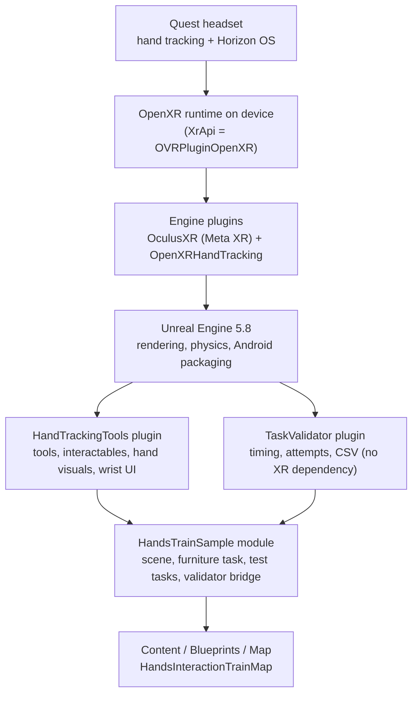
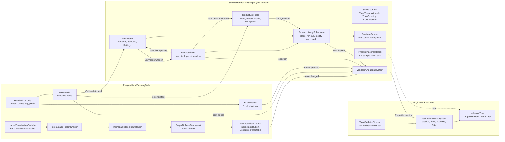

# Software Setup Strategy

How this project keeps a developer machine reproducible, how to get from a fresh clone to a running Quest build, and how the pieces of the software fit together. The [README](../README.md#setup) holds the short quick-reference version of the setup steps. This document explains the reasoning, walks through each step with a check you can run, and describes the architecture behind it.

## Contents

1. [Goal and scope](#1-goal-and-scope)
2. [Pinned baseline](#2-pinned-baseline)
3. [What lives where](#3-what-lives-where)
4. [How the components work together](#4-how-the-components-work-together)
5. [Tutorial: fresh clone to running on a Quest](#5-tutorial-fresh-clone-to-running-on-a-quest)
6. [Technical walkthrough](#6-technical-walkthrough)
7. [Rules](#7-rules)
8. [Upgrading](#8-upgrading)
9. [Troubleshooting](#9-troubleshooting)
10. [Definition of done](#10-definition-of-done)

## 1. Goal and scope

A new developer gets from a fresh clone to the app running on a Quest using only this repository and the pinned versions below. The repository stays small, public-safe, and free of generated files.

The project is a hand-tracking **sample environment** for Meta Quest built on Unreal Engine. It is designed so that you implement your initial test task as an existing task within the sample. It is made of three separate parts:

- **The sample** (`HandsTrainSample`, the game module): the train-themed scene, the furniture placement content, and the test tasks.
- **Hand Tracking Tools** (`Plugins/HandTrackingTools`): the hand tracker. Near-field poke and far-field ray tools, interactables, hand visuals, and wrist UI. It knows nothing about the scene or the study.
- **Task Validator** (`Plugins/TaskValidator`): the validator. It times tasks, counts attempts, judges success and writes a CSV per session. It knows nothing about hands or the scene.

Only the sample depends on both plugins, and a small bridge in the sample connects them. The full explanation is in [PLUGIN_ARCHITECTURE.md](PLUGIN_ARCHITECTURE.md). One setup serves all three parts.

## 2. Pinned baseline

Last verified working set. Change these together, in one commit, and update this table.

| Component | Version | Source of truth |
| --- | --- | --- |
| Unreal Engine | 5.8 (5.8.4 in use) | `HandsTrainSample.uproject` (`EngineAssociation`) |
| Meta XR plugin | 1.207.0 (v207) | `Plugins/MetaXR/OculusXR.uplugin` (local, not committed) |
| Horizon OS SDK | 207 | `Build/Android/ManifestRequirementsAdditions.txt` |
| Android NDK | 27.2.12479018 (r27c) | Engine `Config/Android/Android_SDK.json` |
| Android SDK | build API 36, min 32, target 34 | Engine file above, `Config/DefaultEngine.ini` |
| Package name | `com.samples.HandsTrainSample` | `Config/DefaultEngine.ini` |
| Hand Tracking Tools plugin | 0.1.0 | `Plugins/HandTrackingTools/HandTrackingTools.uplugin` |
| Task Validator plugin | 0.1.0 | `Plugins/TaskValidator/TaskValidator.uplugin` |
| Host OS | Windows 10 or 11 | Engine `Config/Windows/Windows_SDK.json` |

If a version is not visible in a file of this repository or in the engine install, don't guess it. Check the engine's SDK json files.

## 3. What lives where

| Category | Examples | Handling |
| --- | --- | --- |
| Project source | `Source/`, `Config/`, `Content/`, `docs/` | Committed |
| Project plugins (ours) | `Plugins/HandTrackingTools`, `Plugins/TaskValidator` | Committed. Their `Binaries/` and `Intermediate/` are ignored |
| Hand-maintained build input | `Build/Android/ManifestRequirementsAdditions.txt` | Committed (the only tracked file under `Build/`) |
| Licensed SDKs | Meta XR plugin, Interaction SDK | Downloaded by each developer into `Plugins/`, never committed. `.gitignore` ignores everything under `Plugins/` except our two plugins |
| Generated output | `Binaries/`, `Intermediate/`, `Saved/`, `DerivedDataCache/`, `.vs/`, `*.sln`, most of `Build/` | Ignored, rebuilt locally |
| Downloaded tools | `Content/Oculus/Tools/` | Ignored, the Meta XR plugin fetches it on demand |
| Secrets and identity | Meta app IDs and tokens, keystores, passwords | Never committed |

`.gitignore` enforces most of this. The one thing it cannot enforce is the editor rewriting `Config/*.ini` with local values. See [Rules](#7-rules).

## 4. How the components work together

This section describes the whole stack. The reasoning for the split into sample, hand tracker and validator, and a tutorial for putting a first test task into the sample, are in [PLUGIN_ARCHITECTURE.md](PLUGIN_ARCHITECTURE.md). Where this section says "the module", the hand tracking classes now live in the `HandTrackingTools` module (`Plugins/HandTrackingTools`), and the scene and furniture classes in `HandsTrainSample` (`Source/HandsTrainSample`).

### 4.1 The stack, bottom to top



Each layer only talks to the one below it:

- **Device and OpenXR** deliver tracked hand joints. `Config/DefaultEngine.ini` selects the OpenXR path (`XrApi=OVRPluginOpenXR`) and enables hands (`HandTrackingSupport=ControllersAndHands`).
- **Engine plugins** turn those joints into engine objects. The key one is `UOculusXRHandComponent`, which exposes bone transforms and collision capsules. `OpenXRHandTracking` provides Epic's OpenXR hand tracking. The repo must keep using this path, not the legacy MetaXR hand tracking path.
- **The `HandTrackingTools` plugin** depends on those engine plugins through its `Build.cs` (`OculusXRInput`, `HeadMountedDisplay`, and privately `OculusXRHMD`, `XRBase`). Without `Plugins/MetaXR` present, it does not compile, and neither does anything that uses it.
- **The `TaskValidator` plugin** depends only on engine modules, so it builds even without Meta XR.
- **The sample module** (`Source/HandsTrainSample`) depends on both plugins through `HandsTrainSample.Build.cs`.
- **Content** instances the C++ classes. The level `HandsInteractionTrainMap` is both the editor startup map and the game default map, and the default game mode is a Blueprint (`HandsTrainExampleMode`).

### 4.2 The code, by part

The code is in three places. The arrows show what talks to what. The two plugins never talk to each other: the bridge in the sample is the only link.



#### Plugins/HandTrackingTools: the tool and interactable framework

Tools find interactables:

- **`AHandsVisualizationSwitcher`** owns the hand meshes and capsule colliders and switches how hands are drawn.
- **`AInteractableToolsManager`** holds the tools per hand, split into near-field and far-field sets. `AssociateToolWithHand` binds a tool to a hand and registers it.
- **`InteractableToolsInputRouter`** runs each tick and decides which tools are active. Near-field tools take precedence over far-field tools. If a near tool is engaged, the far tools are visually disabled. This is why tools do not manage their own priority.
- **Tools** (`AInteractableTool`): `AFingerTipPokeTool` for near-field poking and `ARayTool` for far-field pointing. Each reports collisions as `FInteractableCollisionInfo` and exposes an input state (`EToolInputState`).
- **Interactables** (`AInteractable`) have three collider zones: proximity, contact and action. A tool entering a zone raises events. Tags filter which tools may drive which interactable. The plugin provides `AInteractableButton` and `ACollidableInteractable`. The sample's train cars, `AControllerBox`, `ATrainCrossing` and `AWindmill` use them.

#### Plugins/HandTrackingTools: hand UI

This part is independent of the framework above. It reads hand data directly:

- **`HandPointerUtils`** is the shared helper. It finds the first player pawn's hand component, returns bone locations, the pointing ray (falling back to camera gaze when a hand isn't tracked) and the thumb-to-index pinch distance.
- **`AWristToolkit`** is the plate on the back of one hand with five items: Menu, Move, Rotate, Navigation, Scale/Dimensions. The other hand's index fingertip pokes an item; poking the selected tool again puts it away. It broadcasts `OnItemActivated` and `OnSelectedToolChanged`.
- **`AButtonPanel`** is a standalone panel of eight labelled poke buttons. It broadcasts `OnButtonPressed` and depends on nothing else.

#### Source/HandsTrainSample: the furniture task

This is sample content built on the hand UI above:

- **`AWristMenu`** is the panel above the toolkit. It subscribes to the toolkit's `OnItemActivated` and opens when the Menu item is poked. Its pages are Products, Selected and Settings. It can undo, redo, remove (with confirmation) and choose a product.
- **`AProductPlacer`** does pointing, selection and placement. A ray from the ray hand hovers products. A pinch and release selects. After the menu chooses a product, the placer shows a green or red ghost, and a fresh pinch and release confirms.
- **`AProductEditTools`** is the behavior behind the toolkit's four tool items. Each tick it reads which tool the toolkit has selected, then uses the placer's ray, pinch state and floor/validation helpers to drive that tool. Move, Rotate and Scale edit the selected product and commit through the history. Navigation teleports the player and never enters the history.
- **`UProductHistorySubsystem`** is a `UWorldSubsystem`. It is the only place products are created and removed. It keeps undo and redo stacks of completed edits (place, remove and modify) and broadcasts `OnHistoryChanged`, `OnEditApplied` and `OnEditRejected`.
- **`AFurnitureProduct`** is a piece of furniture built from boxes. **`UProductCatalogAsset`** is the optional data asset that defines the catalog. With none assigned, the menu uses `MakeDefaultProducts()` (chair, table, desk, sofa, bookshelf).

#### Plugins/TaskValidator: the validator

- **`UTaskValidatorSubsystem`** lives on the game instance. It holds the participant ID, the running task, the timer and counters, and writes one CSV row per finished task to `Saved/ValidatorLogs/`.
- **`AValidatorTask`** is the base for a task placed in a level. `ATargetZoneTask` ("put it in this box") and `AEventTask` ("done when this happens, or when this actor is touched") are ready to use.
- **`ATaskValidatorDirector`** is placed once per level. It starts the session and gives the administrator keys (`N` next, `H` intervention, `X` abandon) and an on-screen overlay.
- Its only input is `UTaskValidatorSubsystem::ReportInteraction(this, Actor)`. It has no XR dependency.

#### Source/HandsTrainSample: the bridge and the test task

- **`UValidatorBridgeSubsystem`** is a world subsystem with no setup. It listens to the hand tracker's events (an interactable entering its action state, a toolkit item poked, a panel button pressed, a product selected, a product edit applied) and calls `ReportInteraction`. For interactables the sample spawns at runtime, it reports the placed owner (the windmill, the crossing or the controller box) so a task can name it.
- **`AProductPlacementTask`** is the sample's initial test task, "place a chair in the marked area". It is a normal validator task that lives in the sample because it depends on the sample's furniture. Implementing your first test task as an existing task within the sample is the intended workflow; see [PLUGIN_ARCHITECTURE.md](PLUGIN_ARCHITECTURE.md#5-tutorial-implement-your-initial-test-task-as-an-existing-task-within-the-sample).

### 4.3 One interaction end to end: placing a chair

1. The user pokes the **Menu** item on the wrist with the free hand. `AWristToolkit` detects the fingertip crossing the item and broadcasts `OnItemActivated(Menu)`.
2. `AWristMenu`, which subscribed to the toolkit at startup, opens and shows the Products page. `OnOpenChanged(true)` fires.
3. The user pokes **Chair**. The menu broadcasts `OnProductChosen` with an `FProductDefinition` and closes.
4. `AProductPlacer` enters placing mode and broadcasts `OnPlacingChanged(true)`. Each tick it casts a ray from the ray hand (`HandPointerUtils::GetRay`) onto the placement area and draws a ghost, green when valid, red with a reason when not.
5. The user pinches and releases. The placer calls `UProductHistorySubsystem::PlaceProduct`.
6. The subsystem spawns an `AFurnitureProduct`, pushes a `Place` edit on the undo stack, clears redo, and broadcasts `OnEditApplied` and `OnHistoryChanged`.
7. The menu reacts to `OnHistoryChanged` by enabling Undo. Poking Undo calls `Undo()`, which removes the chair and moves the edit to the redo stack.

### 4.3.1 One tool end to end: moving the chair

1. With the chair selected (hover it with the ray, pinch and release), the user pokes **Move** on the wrist. `AWristToolkit` makes Move the selected tool. Poking it again puts it away.
2. `AProductEditTools` sees the new tool on its next tick and shows "Pinch and drag to move" over the chair.
3. The user points at the chair and pinches. The tool confirms the ray is on the selected product, takes the floor hit as the grab point, and calls `AProductPlacer::SetToolOwnsPinch(true)`. From now on the placer ignores the pinch, so the release that ends the drag can't select or clear anything.
4. While the pinch is held, each tick the tool moves the chair to the floor hit plus the grab offset, snapped to the placer's grid. `AProductPlacer::ValidateFootprint` checks the placement area and overlaps, ignoring the chair itself. The chair turns green or red, with the reason as a hint.
5. On release with a valid pose, the tool puts the chair back at its starting pose and calls `UProductHistorySubsystem::ModifyProduct` with the new pose. The history records the before and after state as one `Modify` edit, so one Undo returns the chair. An invalid pose is reverted with a message. Losing hand tracking, opening the menu or changing the selection also reverts, and never commits.

The other tools follow the same shape: **Rotate** swings the ray around the product's center and snaps the change to `RotationStepDeg`. **Scale / Dimensions** drags along the product's width and is limited by the capabilities in `FProductCapabilities` (`bResizable`, `MinWidthCm`, `MaxWidthCm`). **Navigation** shows a disc on the floor under the ray, green when the player may go there and red when not. A fresh pinch and release moves the player's tracking origin so their head ends up over the disc.

Why it is built this way:

- **Events, not references.** The toolkit, menu and placer find each other with a `TActorIterator` at startup and then only communicate through delegates, so each can be tested or replaced alone. Place one of each in the level and they connect themselves.
- **One writer for product state.** Because only the history subsystem creates and removes products, undo can never disagree with what is in the world, and a failed edit is reported through `OnEditRejected` and never half-applied.
- **Selection and tool changes never enter history.** Only completed place, remove and modify edits do. A drag is a live preview and becomes an edit only on a valid release, so one drag is always one Undo.
- **The tools read, the placer owns the gesture.** Pinch detection, the ray and the placement rules live in `AProductPlacer`, so the tools can't disagree with placement about what is valid.

### 4.4 How the configuration ties the code to the device

| Config | Value | What depends on it |
| --- | --- | --- |
| `GameTraceChannel1` `FarField` | trace channel | `ARayTool` far-field hits |
| `GameTraceChannel2` `HandCapsuleOrTool` | object channel | hand capsules and poke tools |
| `GameTraceChannel3` `InteractableCollisionZone` | object channel | the proximity, contact and action zones of `AInteractable` |
| `XrApi=OVRPluginOpenXR`, `HandTrackingSupport=ControllersAndHands` | Meta XR runtime settings | every hand-tracking read in the module |
| `r.Mobile.ShadingPath=0`, `r.ForwardShading=True`, `r.MobileMSAA=4`, `vr.MobileMultiView=True` | renderer | mobile forward shading with MSAA, the Quest-friendly path |
| `bBuildForArm64=True`, `bSupportsVulkan=True`, `bPackageForMetaQuest=True` | Android runtime | the packaged APK targets Quest |
| `MinSDKVersion=32`, `TargetSDKVersion=34` | Android runtime | manifest API levels |
| `horizonos:minSdkVersion/targetSdkVersion="207"` | `ManifestRequirementsAdditions.txt` | Horizon OS SDK level in the manifest |
| `com.oculus.supportedDevices` | `quest2\|questpro\|quest3\|quest3s` | which headsets can install the app |

If you rename or reorder the custom collision channels, every interactable and tool in the content breaks silently. Treat `DefaultEngine.ini` channel names as part of the code's API.

## 5. Tutorial: fresh clone to running on a Quest

Each step ends with a **Check**. Do not move on until it passes. The order follows the dependency chain: each step needs the one before it.

### Step 1: Host tools

1. Install **Git** and run `git lfs install`.
2. Install **Visual Studio** (2022 17.14, or 2026 with MSVC 14.50.35723 or later) with the **Game development with C++** workload.
3. Make sure a Windows SDK (10.0.22621 or compatible) is installed.

**Check:** `git --version` and `git lfs version` print versions, and Visual Studio Installer shows the C++ game workload as installed.

### Step 2: Install the engine

1. Install the Epic Games Launcher.
2. Under **Unreal Engine > Library**, install **5.8**.
3. In the install options, tick **Android** as a target platform.

**Check:** the engine launches, and `Engine\Extras\Android\SetupAndroid.bat` exists in the install folder.

### Step 3: Install the Android toolchain

The engine decides the toolchain versions, so use the engine's own installer script, not hand-picked versions.

1. Install **Android Studio** and open it once so it finishes SDK setup.
2. Run `Engine\Extras\Android\SetupAndroid.bat`. It installs the NDK, platform, build-tools and CMake that the engine expects.
3. In Android Studio's SDK Manager, also install **Android 14 (API 34)**, the project's target level.
4. Set `ANDROID_HOME`, `NDKROOT` and `JAVA_HOME` (use the `jbr` folder bundled with Android Studio), then sign out and back in or restart your terminal.

Meta's docs list NDK 25.1.8937393, but UE 5.8 requires r27c, so use `27.2.12479018`.

**Check:** in a new terminal, `echo %ANDROID_HOME%`, `echo %NDKROOT%` and `echo %JAVA_HOME%` each print a real path, and the NDK folder name ends in `27.2.12479018`.

### Step 4: Clone the repository

```sh
git lfs install
git clone https://github.com/Bvqlz/UI-Library
cd UI-Library
```

Assets are currently in plain Git, not LFS. The `git lfs install` is harmless and is kept in case assets move.

**Check:** `HandsTrainSample.uproject`, `Source/HandsTrainSample/` and `Content/` exist, and `git status` is clean.

### Step 5: Install the Meta XR plugin

The plugin is licensed and not in the repository. The project does not compile without it.

1. Download **Meta XR plugin v207** from the [Unreal Engine 5 Integration page](https://developers.meta.com/vr/downloads/package/unreal-engine-5-integration/). Choose version 207 if a newer one is shown.
2. Extract it so this file exists: `Plugins/MetaXR/OculusXR.uplugin`.
3. Optional: the Meta Interaction SDK goes in `Plugins/MetaXRInteraction/OculusInteraction.uplugin`. No project code uses it today.

**Check:** `Plugins/MetaXR/OculusXR.uplugin` exists, and its `EngineVersion` matches 5.8. `git status` must still be clean, because `/Plugins/` is ignored.

### Step 6: Build and open the project

1. Right-click `HandsTrainSample.uproject` and choose **Generate Visual Studio project files**.
2. Open the generated `.sln` and set `HandsTrainSample` as the startup project.
3. Choose **Development Editor** and **Win64**.
4. Press `F5`. The first build is slow.

The editor opens on `HandsInteractionTrainMap`. If the Meta XR Project Setup Tool flags something, review it under **Edit > Project Settings > Plugins > Meta XR**. It may report the NDK version from step 3, which is expected.

**Check:** the build finishes with no errors, the editor opens, and the map loads. In **Edit > Plugins**, `OculusXR`, `OpenXRHandTracking`, `HandTrackingTools` and `TaskValidator` are enabled, and **Window > Place Actors** has a **Task Validator** tab.

### Step 7: Try placing products in the editor (no headset)

The wrist classes have editor fallbacks, so you can verify the logic before touching a device. Press Play in the editor, then:

| Key | Action |
| --- | --- |
| `M` | Open or close the wrist menu |
| `1` to `5` | Choose a product while the Products page is showing |
| `Space` | Pinch and release (confirm placement or select) |
| `Escape` | Cancel placement |
| `Z` / `Y` | Undo / redo |

Without a tracked wrist, the menu floats in front of the camera and the ray falls back to the camera's gaze.

**Check:** pressing `M`, then `1`, then `Space` places a product, and `Z` removes it and `Y` brings it back.

### Step 8: Try the toolkit tools in the editor

Place an `AWristToolkit`, `AWristMenu`, `AProductPlacer` and `AProductEditTools` in the level (one of each). Press Play, place a product as in step 7, then:

| Key | Action |
| --- | --- |
| `G` / `R` / `B` | Select Move / Rotate / Scale. Press the same key again to put the tool away |
| `N` | Select Navigation |
| `Space` | Start a drag on the selected product, then `Space` again to commit it. In Navigation, `Space` teleports |
| `Escape` | Cancel a drag |
| `Z` / `Y` | Undo / redo, which now also cover moves, rotations and resizes |

Aim at the selected product with the camera. Without a headset, the camera's gaze stands in for the ray.

**Check:** with a product selected, `G`, `Space`, turn the view, `Space` moves it and turns it red where it would overlap; `Z` puts it back. `B` widens a table but shows "This product can't be resized" for a chair. `N` shows a disc on the floor, and `Space` moves the view there.

### Step 9: Run a test task and read the CSV (no headset)

This checks the validator, the bridge and the hand tracker's events together. The sample is a host environment, and your initial test task is one of the interactions it already has; here you wrap one as a task. The full explanation is in [PLUGIN_ARCHITECTURE.md](PLUGIN_ARCHITECTURE.md#5-tutorial-implement-your-initial-test-task-as-an-existing-task-within-the-sample).

1. Open `HandsInteractionTrainMap` and **File > Save Current Level As…** `ValidatorTestMap`, so the sample map stays clean.
2. From **Window > Place Actors > Task Validator**, drag in a **Task Validator Director** and set **Participant Id** to `P01`.
3. Add a task. Either:
   - an **Event Task** with Task Group `Selection`, Task Name `SelectWindmill`, and the windmill in **Complete On Interaction With**, or
   - a **Product Placement Task** (from the sample's C++ classes) with Required Type `Chair`, in a level that has the wrist toolkit, menu, placer and edit tools.
4. Press Play, click in the viewport, and press `N` to start the task. Do the task (for the placement task, use the editor keys from step 7), or use the console command `Validator.ForceComplete`.
5. Stop Play and open `Saved/ValidatorLogs/P01_validator.csv`.

**Check:** the file has one row for the task with `Result` set to `Completed`. When you did the task through the sample's interactions, `Attempts` is at least 1 and `TimeToFirstInteraction_s` is filled in, which shows the bridge delivered the hand tracker's event. If you used only `Validator.ForceComplete`, those two stay empty, which is expected.

### Step 10: Package and run on a Quest

1. Enable developer mode on the headset, connect it over USB, and accept the debugging prompt inside the headset.
2. In the editor, choose **Platforms > Android > Package Project** and pick an output folder.
3. Install and launch with `hzdb` (the Quest-aware ADB wrapper):

   ```sh
   npx -y @meta-quest/hzdb device list
   npx -y @meta-quest/hzdb app install <path to your .apk>
   npx -y @meta-quest/hzdb app launch com.samples.HandsTrainSample
   ```

**Check:** `device list` shows the headset. The app launches, your tracked hands appear, and poking the wrist menu works. Use `hzdb` for logs and screenshots too, instead of raw `adb`.

### Alternative: build the Meta fork of Unreal

Choose this if you want CPU occlusion on Quest 2. You need linked Epic and GitHub accounts, as described in [Accessing Unreal Engine source code on GitHub](https://www.unrealengine.com/en-US/ue-on-github). The fork already includes the Meta XR plugin, so skip step 5. Use a branch that matches 5.8, then from the engine root:

```sh
.\GenerateProjectFiles.bat -Game HandsTrainSample -Engine <full path to this repository>\HandsTrainSample.uproject
```

Open `HandsTrainSample.sln` and continue from step 6.

## 6. Technical walkthrough

### 6.1 What happens when the project builds

1. Unreal Build Tool reads `HandsTrainSample.uproject`. It finds one game module, `HandsTrainSample` (type Runtime, default loading phase), and the plugin list, which includes our two project plugins.
2. It resolves each plugin. `OculusXR` is looked up in `Plugins/MetaXR` (or the engine, in the Meta fork). If it is missing, the build fails with the plugin load error from [Troubleshooting](#9-troubleshooting). `HandTrackingTools` and `TaskValidator` are found in `Plugins/` and contribute their own modules (`HandTrackingTools`; `TaskValidator`, `TaskValidatorDemo`, `TaskValidatorEditor`).
3. It compiles each module with its own dependencies, plugins first. `HandTrackingTools` needs `OculusXRInput` and `HeadMountedDisplay` publicly. `TaskValidator` needs only engine modules. The game module then compiles with `HandTrackingTools` and `TaskValidator` added to its dependencies in `HandsTrainSample.Build.cs`.
4. Unreal Header Tool generates `*.generated.h` for every `UCLASS`, `USTRUCT`, `UENUM` and delegate. This is why a header edit can force a wide rebuild.

The uproject also enables many editor toolset plugins (`ModelContextProtocol`, `MCPClientToolset`, `EditorToolset` and similar). They are editor-side tooling for agent access. The Quest app does not depend on them.

### 6.2 What happens when the app is packaged

1. The editor cooks content for Android with ASTC, DXT and ETC2 texture formats enabled (`bMultiTargetFormat_*`).
2. It builds `arm64` native code only (`bBuildForArm64=True`, `bBuildForX8664=False`) with Vulkan (`bSupportsVulkan=True`).
3. The Android project generator writes the manifest from `AndroidRuntimeSettings`, then merges `Build/Android/ManifestRequirementsAdditions.txt`. That file contributes the Horizon OS SDK element (`minSdkVersion` and `targetSdkVersion` of 207). The `com.oculus.supportedDevices` entry comes from `ExtraApplicationSettings`.
4. Gradle builds the APK using the NDK, SDK platform, build-tools and JDK from step 3. The APK is unsigned for store use. `KeyStore` fields stay empty in the repo.

Almost everything else under `Build/` is generated during packaging, which is why it is ignored.

### 6.3 What happens at runtime on the headset

1. The app starts into `HandsInteractionTrainMap` with the default game mode from `DefaultEngine.ini`. `bStartInVR=True` makes it start in VR.
2. The runtime reports hand tracking. Hand components expose bones and capsule colliders.
3. The wrist actors call `FindHands()` on their first ticks (the toolkit and button panel retry until the pawn's hand components exist), then start reading fingertip positions each frame.
4. Each tick, the toolkit tests the poking hand's `Index_Tip` against its item buttons, in the toolkit's own local space. A press needs the tip to start above a button, travel inside its radius and below its press height, and respect a cooldown, so jitter doesn't double-fire.
5. Events flow as described in [4.3](#43-one-interaction-end-to-end-placing-a-chair).
6. During a study session, the validator's bridge turns the same events into `ReportInteraction` calls. The validator counts them as attempts only while a task is running, and it ignores them otherwise. The administrator keys need a keyboard on the PC, so run study sessions through Quest Link from the editor (see [validator/GUIDE.md](validator/GUIDE.md), Part 5), not from a standalone APK.

### 6.4 Performance model

- Rendering is mobile forward with 4x MSAA, no bloom, no auto exposure, no motion blur. Don't re-enable these without measuring.
- On **Quest 2**, GPU occlusion queries cause severe FPS drops. The documented fixes, in order: (a) use the Meta fork (UE 5.5.4 or later) with CPU occlusion, or (b) run `r.AllowOcclusionQueries 0` through an `ExecuteConsoleCommand` node, as `LevelBlueprint` does. Try these before proposing alternatives.
- Use `hzdb` Perfetto trace capture for on-device profiling.

## 7. Rules

- **The engine decides toolchain versions.** If external docs disagree, follow the engine's `Android_SDK.json` and `Windows_SDK.json`.
- **Keep the engine and plugin matched.** The plugin declares the engine version it supports in `EngineVersion`.
- **Upgrade on a branch.** See [Upgrading](#8-upgrading).
- **Keep publishing credentials out of `Config/`.** Enter them only for an upload, and clear them before committing. Check `git diff Config/` before every commit, since the editor rewrites these files. The Android file server's `SecurityToken` in `DefaultEngine.ini` is an editor-generated value. Review it rather than assuming it is safe to share.
- **Keep the three parts separate.** The plugins never include sample headers or each other. Only the sample's bridge connects them, and tasks live in the sample. The rules and a check are in [PLUGIN_ARCHITECTURE.md](PLUGIN_ARCHITECTURE.md#9-rules-that-keep-the-separation).
- **Use Epic's OpenXR path.** The project relies on OpenXR hand tracking. Don't revert to the legacy MetaXR path.
- **Keep custom collision channel names stable** (see [4.4](#44-how-the-configuration-ties-the-code-to-the-device)).
- **One writer for product state.** New code that creates or removes products goes through `UProductHistorySubsystem`.
- **Run device work through `hzdb`.** Install, launch, logs, screenshots and traces all go through it.

## 8. Upgrading

1. Create a branch.
2. Change the engine association (or the plugin) and the manifest SDK level together.
3. Regenerate project files and rebuild `Development Editor`. Fix compile errors from API changes.
4. Run the editor-only checks from steps 7 and 8, and the test task from step 9.
5. Package and test on a headset, with hands.
6. Update the [Pinned baseline](#2-pinned-baseline), the README requirements table and the changelog in the same commit.

## 9. Troubleshooting

| Problem | Likely cause | Fix |
| --- | --- | --- |
| `Plugin 'OculusXR' failed to load` or missing `OculusXR*` modules | Plugin not installed or in the wrong folder | Check `Plugins/MetaXR/OculusXR.uplugin` (step 5) |
| The editor asks to rebuild modules | Expected on a fresh clone | Accept, or build from Visual Studio (step 6) |
| Android packaging can't find the SDK or NDK | Environment variables missing or stale | Recheck step 3, then restart the editor |
| NDK version warning in the Meta XR Project Setup Tool | Meta's docs list an older NDK | Ignore it. Use the engine's r27c |
| Build fails after switching plugin versions | Plugin and engine mismatch | Match `EngineVersion` in the `.uplugin` to 5.8 |
| Low FPS on Quest 2 | GPU occlusion queries | See [6.4](#64-performance-model) |
| Blueprints or the map show missing classes after the plugin split | The moved classes' module path changed | Check the `[CoreRedirects]` section in `Config/DefaultEngine.ini`, then follow the clean-up in [PLUGIN_ARCHITECTURE.md section 8](PLUGIN_ARCHITECTURE.md#8-what-moved-and-what-that-does-to-existing-content) |
| Linker error for a `HandTrackingTools` symbol used by the sample | A class or function is missing its `HANDTRACKINGTOOLS_API` export | Add the macro to the declaration |
| Task Validator tab missing in Place Actors | The editor build predates the plugin, or an old binary | Close the editor and rebuild (step 6) |
| Validator counts no attempts | The thing touched is not one the bridge listens to | See the table in [PLUGIN_ARCHITECTURE.md section 4](PLUGIN_ARCHITECTURE.md#4-how-they-work-together-at-runtime) |
| Hands show but poke does nothing | Wrist actors missing from the level, or hand tracking off | Place `AWristToolkit` and `AWristMenu` in the level, and check `HandTrackingSupport` and the headset's hand tracking setting |
| App doesn't appear on the headset | Wrong device filter or developer mode off | Check `com.oculus.supportedDevices` and developer mode |

## 10. Definition of done

Setup is complete when:

- a fresh clone compiles the `Development Editor` target,
- `HandsInteractionTrainMap` opens in the editor,
- the editor-only checks in steps 7 and 8 place, move, rotate, resize, undo and redo a product,
- the test task in step 9 completes and writes a CSV row, and
- a packaged build launches on a Quest with hand tracking working.

## Known gaps

- `AProductEditTools` must be placed in the level next to the toolkit, menu and placer.
- Scale / Dimensions changes width only. Height and depth stay fixed at the catalog size.
- Navigation moves the player in the floor plane and does not check for walls. It only refuses destinations that are too far or inside a product's footprint.
